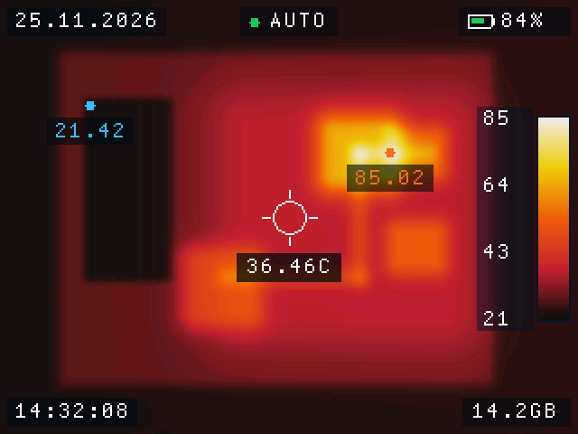
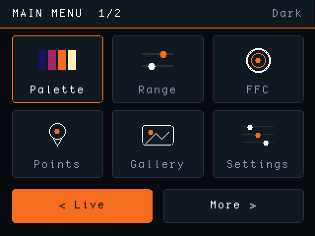
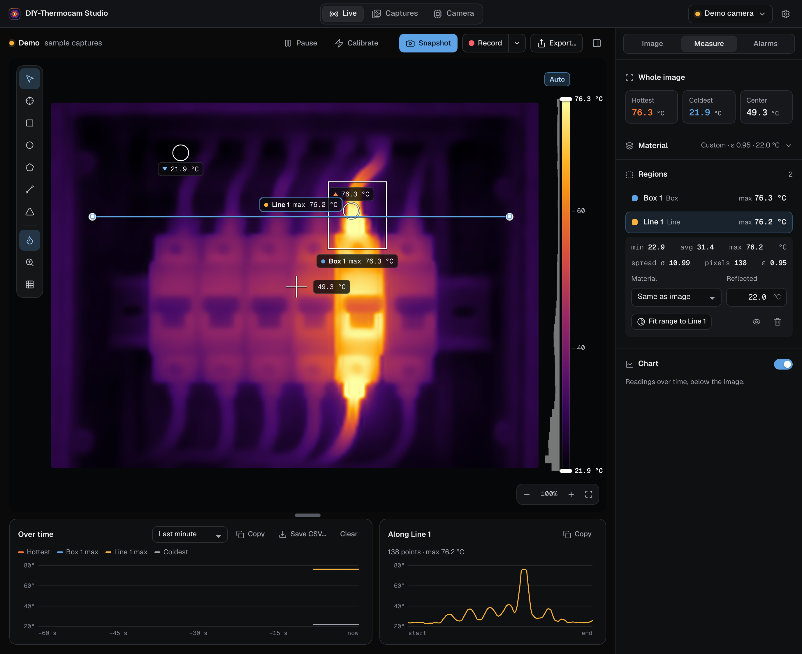

<div align="center">

<picture>
  <source media="(prefers-color-scheme: dark)" srcset="website/public/images/brand/logo-dark.svg">
  
</picture>

<br>

**Build your own open-source radiometric thermal camera.**<br>
160×120 long-wave infrared (-10 °C to +450 °C, &lt; 50 mK NETD) on FLIR Lepton 3.5 or 3.1R and Teensy 4.1.

<p>
  <a href="docs/building-instructions.md">Build</a> ·
  <a href="app/">App</a> ·
  <a href="firmware/">Firmware</a> ·
  <a href="docs/">Docs</a> ·
  <a href="https://www.diy-thermocam.net">Website</a>
</p>


</div>

---

## What it is

DIY-Thermocam is an open-source hardware and software thermal imager licensed under GPL-3.0. It pairs a radiometric FLIR Lepton sensor and Teensy 4.1 with a 3.2-inch touchscreen, open KiCad schematics, parametric enclosures, and a cross-platform desktop app.

Radiometric `.DAT` files stay byte-compatible with files from earlier DIY-Thermocam cameras.

| Assembly | Power &amp; USB | Est. BOM (incl. Lepton 3.5) |
| --- | --- | --- |
| Two factory-assembled boards (main board and Lepton carrier), two small screwdrivers and two nut drivers (4 mm and 5 mm), no soldering | USB-C, TI BQ24074 charger, TPS61022 boost, 3.3 V RTC LDO | ~$293 (~$121 excl. sensor) |

## On the camera and on your computer

| Firmware 4.0 Live HUD | Firmware 4.0 Touchscreen UI | Desktop Studio (macOS, Windows, Linux) |
| :---: | :---: | :---: |
|  |  |  |

- **Standalone touchscreen camera:** 3.2-inch display, 19 color palettes, Dark/Light/High-Contrast themes, auto or manual range, up to 96 temperature spots, and 4–6 hours on a 2000 mAh LiPo (about 60 % of that on the 1200 mAh Adafruit cell).
- **Firmware 4.0 on Teensy 4.1:** Verified on real hardware at **8.77 fps** USB streaming, **0.26 ms** median command latency, and **9.20 MB/s** direct microSD reads ([Protocol v2](docs/protocol-v2.md)).
- **Desktop Studio ([Tauri v2](https://github.com/tauri-apps/tauri) + Rust + WebGL2):** Native macOS, Windows, and Linux app. **Live** measures regions with their own emissivity, sets alarms and exports MP4/TIFF. **Captures** keeps full-temperature snapshots and recordings on your computer, reads the camera's microSD card, and saves edits with Undo. **Camera** holds settings and firmware updates.

## Quick start

**Prerequisites:** macOS 12+, Windows 10/11, or Linux (add your user to the `dialout` group and install [PJRC `00-teensy.rules`](https://www.pjrc.com/teensy/00-teensy.rules); see [Linux USB permissions](docs/manual.md#linux-usb-permissions)), plus a data-capable USB-C cable.

**Firmware** — Firmware 4.0 supports **DIY-Thermocam V3 and V4** (Teensy 4.1). V1 and V2 cameras (Teensy 3.2/3.6) must stay on [Firmware 2.4.8](https://github.com/maxritter/diy-thermocam/releases/tag/2.4.8). Download a prebuilt `.hex` from [GitHub Releases](https://github.com/maxritter/diy-thermocam/releases) and install it in Desktop Studio (**Camera › Update firmware…**), or build from source with [Arduino CLI](https://github.com/arduino/arduino-cli):

```bash
cd firmware && arduino-cli compile
```

See [`firmware/README.md`](firmware/README.md) for Windows, macOS, and Linux flashing instructions.

**Desktop App** — download an installer from [GitHub Releases](https://github.com/maxritter/diy-thermocam/releases), or build locally in `app/`:

```bash
cd app && bun install && bun run build
```

**Hardware** — order the parts from the [interactive Bill of Materials](https://www.diy-thermocam.net/docs/partlist/), then follow the [Building Instructions](docs/building-instructions.md).

<details>
<summary><b>Developer checks and local test commands</b></summary>

```bash
# Firmware host unit tests, interactive UI simulator tests, and static checks
make -C firmware/tests_host test
make -C firmware/sim test
make -C firmware/sim screenshots

# Live hardware regression suite (45 automated v1 + v2 tests on connected camera)
cd firmware/test && pytest --baseline baseline-3.0.4.json

# Desktop app checks
cd app && cargo clippy --workspace --all-targets -- -D warnings && cargo test --workspace && bun run lint && bun test

# Website build and verification
cd website && bun run lint && bun run check && bun run build && bun scripts/verify-dist.mjs

# Hardware BOM, KiCad ERC/DRC, and enclosure geometry tests
python3 hardware/bom/validate_bom.py
kicad-cli sch erc --severity-error --exit-code-violations hardware/pcb/diy-thermocam-v4.0.kicad_sch
kicad-cli pcb drc --refill-zones --severity-error --exit-code-violations hardware/pcb/diy-thermocam-v4.0.kicad_pcb
cd hardware/enclosure/cad && uv run --extra dev --python 3.12 pytest
```

Enable the local pre-commit hook with `git config core.hooksPath .githooks`. The original Windows and Python tools stay archived at git tag [`3.0.4`](https://github.com/maxritter/diy-thermocam/tree/3.0.4/software).

</details>

## Repository

| Path | Contents |
| --- | --- |
| [`firmware/`](firmware/) | Teensy 4.1 C++17 firmware ([Arduino CLI](https://github.com/arduino/arduino-cli)), host unit tests, interactive UI simulator, 45-test hardware suite |
| [`app/`](app/) | Cross-platform [Tauri v2](https://github.com/tauri-apps/tauri) + Rust + React 19 Desktop Studio |
| [`hardware/pcb/`](hardware/pcb/) | Native KiCad 10 V4.0 PCB, Gerbers, BOM/CPL exports, and 3D STEP model |
| [`hardware/enclosure/`](hardware/enclosure/) | Parametric [build123d](https://github.com/gumyr/build123d) CAD for the 3D-printed shell and 3 mm laser-cut acrylic case, plus Blender renders |
| [`hardware/bom/`](hardware/bom/) | Single-source `bom.csv`, schema validator, and order guide |
| [`docs/`](docs/) · [`website/`](website/) | Manuals, protocol specs, and Astro + Starlight site for [www.diy-thermocam.net](https://www.diy-thermocam.net) |

## License and credits

Released under the **GNU General Public License v3.0** ([LICENSE](LICENSE)).

- **ThermoVision** by [Joe-C](http://joe-c.de/pages/projekte/thermovision.php) — third-party Windows radiometric viewer for `.DAT` files.
- **Community 3.0b Enclosure** by [helmarw/DIY-Thermocam](https://github.com/helmarw/DIY-Thermocam/tree/master/Enclosure/3.0b) — inspired ergonomic details of the 3D-printed shell.

Created by [Max Ritter](https://maxritter.net) · [Contributing](CONTRIBUTING.md) · [Changelog](CHANGELOG.md)
