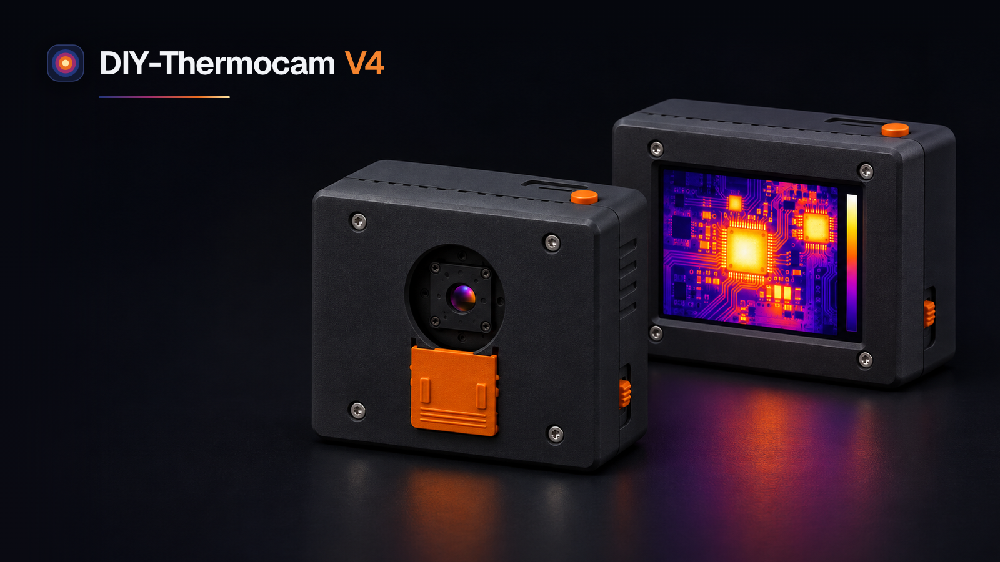

<div align="center">

<picture>
  <source media="(prefers-color-scheme: dark)" srcset="website/public/images/brand/logo-dark.svg">
  
</picture>

<br>

**Build your own open-source radiometric thermal camera.**<br>
160×120 long-wave infrared (-10 °C to +450 °C, &lt; 50 mK NETD) on FLIR Lepton 3.5 or 3.1R and Teensy 4.1.

<p>
  <a href="docs/building-instructions.md">Build</a> ·
  <a href="app/">App</a> ·
  <a href="firmware/">Firmware</a> ·
  <a href="docs/">Docs</a> ·
  <a href="https://www.diy-thermocam.net">Website</a>
</p>



</div>

---

## What it is

DIY-Thermocam is an open-source hardware and software thermal imager licensed under GPL-3.0. It pairs a radiometric FLIR Lepton sensor and Teensy 4.1 with a 3.2-inch touchscreen, open KiCad schematics, parametric enclosures, and a cross-platform desktop app.

Every radiometric `.DAT` file stays byte-compatible across V1, V2, V3, and V4 cameras.

| Revision | Status | Assembly | Power &amp; USB | Est. BOM (incl. Lepton 3.5) |
| --- | --- | --- | --- | --- |
| **V3.0 Classic** | Proven default (tag `3.0.4`) | Hand-soldered through-hole PCB | Micro-USB, TP4056, Pololu 5 V boost, CR1220 | ~$367 (~$195 excl. sensor) |
| **V4.0 Zero-Solder** | `PROTOTYPE-PENDING` | Factory PCBA + Phillips screwdriver | USB-C, TI BQ24074 charger, TPS61022 boost, 3.3 V RTC LDO | ~$333 (~$161 excl. sensor) |

> **Prototype status:** V4.0 (`hardware/pcb/` and `hardware/enclosure/exports/3d-v4.0/`) is `PROTOTYPE-PENDING` until physical hardware bring-up is complete. Use V3.0 (tag `3.0.4`) for a proven build today.

## Highlights

- **Standalone touchscreen camera:** 3.2-inch display, 19 color palettes, auto or manual range, up to 96 temperature spots, and 4–6 hours on a 2000 mAh LiPo.
- **Firmware 4.0 on Teensy 4.1:** Verified on real V3 hardware at **8.77 fps** USB streaming, **0.26 ms** median command latency, and **9.20 MB/s** direct microSD reads ([Protocol v2](docs/protocol-v2.md)).
- **Cross-platform Desktop Studio:** Native Tauri v2 + Rust + WebGL2 app for macOS, Windows, and Linux. Offers Standard and Pro modes, ROI emissivity, MP4 and 16-bit TIFF export, SD browsing, and HalfKay updates.

## Quick start

**Firmware** — download a release `.hex` from [GitHub Releases](https://github.com/maxritter/diy-thermocam/releases), or build from source with `arduino-cli`:

```bash
cd firmware && arduino-cli compile
```

**Desktop App** — download an installer from [GitHub Releases](https://github.com/maxritter/diy-thermocam/releases), or build locally in `app/`:

```bash
cd app && bun install && bun run build
```

**Hardware** — pick V3.0 or V4.0 in the [interactive Bill of Materials](https://www.diy-thermocam.net/docs/partlist/), then follow the [Building Instructions](docs/building-instructions.md). Already own a V3? See the [V3 → V4 prototype order list](hardware/bom/README.md#v3--v4-first-prototype-order-list-minimum-vendors).

<details>
<summary><b>Developer checks and local test commands</b></summary>

```bash
# Firmware host tests and virtual simulator
make -C firmware/tests_host test
make -C firmware/sim

# Desktop app checks
cd app && cargo clippy --workspace --all-targets -- -D warnings && cargo test --workspace && bun run lint && bun test

# Website build and verification
cd website && bun run lint && bun run check && bun run build && bun scripts/verify-dist.mjs

# Hardware BOM, KiCad ERC/DRC, and enclosure geometry tests
python3 hardware/bom/validate_bom.py
kicad-cli sch erc --severity-error --exit-code-violations hardware/pcb/diy-thermocam-v4.0.kicad_sch
kicad-cli pcb drc --refill-zones --severity-error --exit-code-violations hardware/pcb/diy-thermocam-v4.0.kicad_pcb
cd hardware/enclosure/cad && uv run --extra dev --python 3.12 pytest
```

Enable the local pre-commit hook with `git config core.hooksPath .githooks`. Legacy V3.0 Windows and Python tools stay archived at git tag [`3.0.4`](https://github.com/maxritter/diy-thermocam/tree/3.0.4/software).

</details>

## Repository

| Path | Contents |
| --- | --- |
| [`firmware/`](firmware/) | Teensy 4.1 C++17 firmware (`arduino-cli`), host unit tests, virtual simulator, hardware test suite |
| [`app/`](app/) | Cross-platform Tauri v2 + Rust + React 19 Desktop Studio |
| [`hardware/pcb/`](hardware/pcb/) | Native KiCad 10 V4.0 PCB, Gerbers, BOM/CPL exports, and 3D STEP model |
| [`hardware/enclosure/`](hardware/enclosure/) | Parametric `build123d` CAD for 3D/CNC shells and 3 mm laser-cut acrylic |
| [`hardware/bom/`](hardware/bom/) | Single-source `bom.csv`, schema validator, and prototype order guide |
| [`docs/`](docs/) · [`website/`](website/) | Manuals, protocol specs, and Astro + Starlight site for [www.diy-thermocam.net](https://www.diy-thermocam.net) |

## License and credits

Released under the **GNU General Public License v3.0** ([LICENSE](LICENSE)).

- **ThermoVision** by [Joe-C](http://joe-c.de/pages/projekte/thermovision.php) — third-party Windows radiometric viewer for `.DAT` files.
- **Community 3.0b Enclosure** by [helmarw/DIY-Thermocam](https://github.com/helmarw/DIY-Thermocam/tree/master/Enclosure/3.0b) — inspired ergonomic details of the 3D-printed shell.

Created by [Max Ritter](https://maxritter.net) · [Contributing](CONTRIBUTING.md) · [Changelog](CHANGELOG.md)
