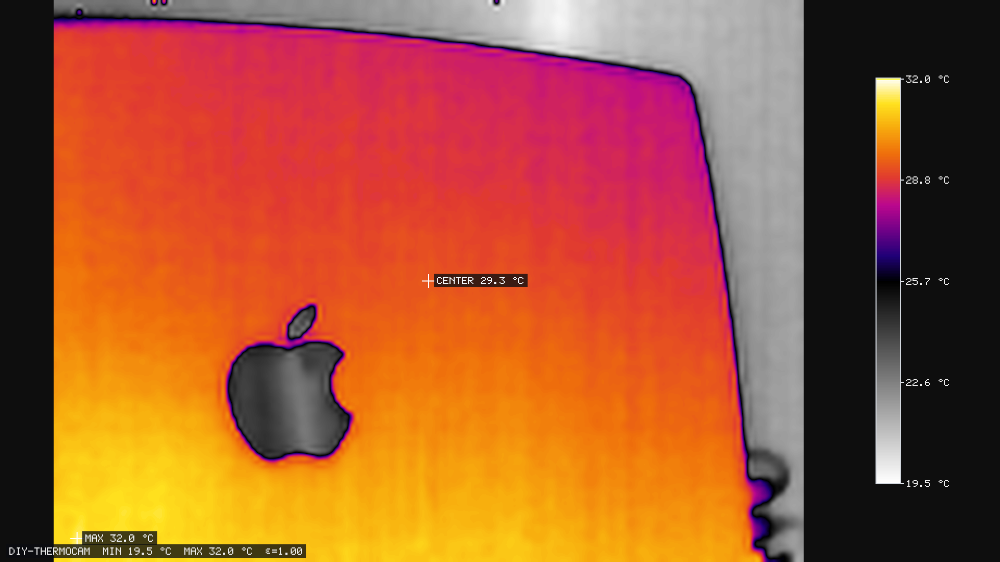
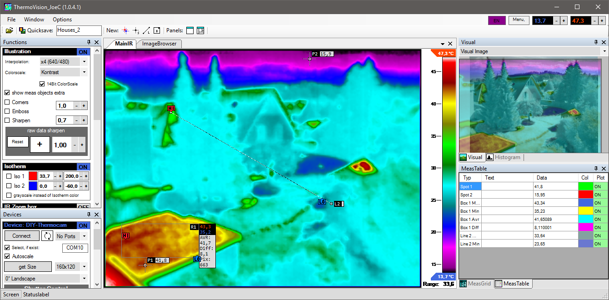
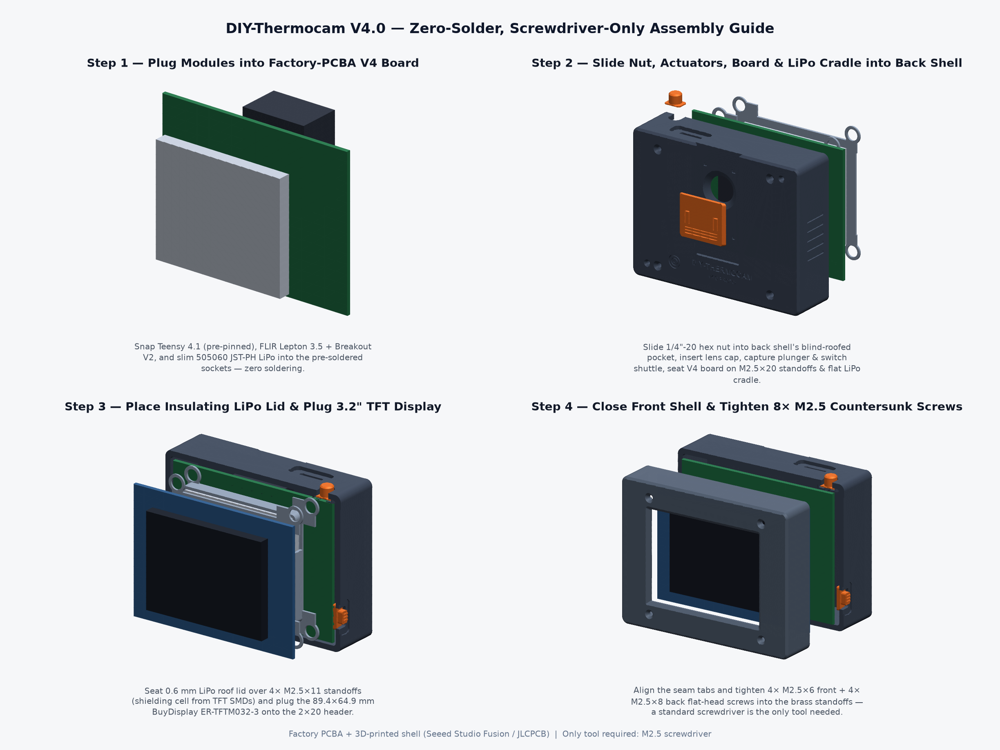

<div align="center">

<picture>
  <source media="(prefers-color-scheme: dark)" srcset="website/public/images/brand/logo-dark.svg">
  
</picture>

<br>

**Build your own radiometric thermal imager — open KiCad hardware, Teensy 4.1 firmware, and a cross-platform Desktop Studio.**<br>
160×120 LWIR radiometric imaging (-10 °C to +450 °C, < 50 mK NETD) on FLIR Lepton 3.5 or wide-angle 3.1R.

<a href="https://github.com/maxritter/diy-thermocam/releases"></a>
<a href="LICENSE"></a>
<a href="https://www.diy-thermocam.net"></a>
<a href="https://github.com/maxritter/diy-thermocam"></a>

<p>
  <a href="#hardware-v30-vs-v40">Build V4</a> ·
  <a href="#desktop-studio">Desktop Studio</a> ·
  <a href="#firmware-40-benchmarks">Firmware 4.0</a> ·
  <a href="docs/">Docs</a> ·
  <a href="https://www.diy-thermocam.net">Website</a> ·
  <a href="https://github.com/maxritter/diy-thermocam/releases">Releases</a>
</p>


<sub>DIY-Thermocam V4.0 chamfered 3D/CNC shell and green ENIG-gold zero-solder PCBA (<code>PROTOTYPE-PENDING</code>). Proven V3.0 through-hole hardware remains buildable today.</sub>

</div>

---

## What ships in this monorepo

DIY-Thermocam is a complete open-source thermal camera platform: native KiCad 10 PCBs, parametric `build123d` enclosures, single-source BOM, Teensy 4.1 C++17 firmware with binary USB Protocol v2, a cross-platform Tauri v2 + Rust Desktop Studio, and the official documentation site. Every radiometric `.DAT` file remains 100% compatible across V1, V2, V3, and V4.

| Subsystem | Path | What you get |
| --- | --- | --- |
| **Firmware 4.0** | [`firmware/3.0/`](firmware/3.0/) | Teensy 4.1 C++17 firmware (`arduino-cli`, Teensy core 1.62.0), binary USB Protocol v2, double-buffered VoSPI, direct SD access, host unit tests, and virtual camera simulator |
| **Desktop Studio** | [`app/`](app/) | Cross-platform Tauri v2 + Rust + React 19 + WebGL2 app for macOS, Windows, and Linux (`Standard \| Pro` modes, H.264 MP4, 16-bit Kelvin TIFF, SD browser, HalfKay updater) |
| **KiCad 10 PCBs** | [`hardware/pcb/`](hardware/pcb/) | Verified 1:1 KiCad 10 port of proven V3.0 (plus untouched Eagle baseline) and zero-solder V4.0 PCBA with Gerbers, BOMs, CPLs, and 3D STEP exports |
| **Parametric CAD** | [`hardware/enclosure/`](hardware/enclosure/) | `build123d` support-free 3D/CNC shells (`STEP`, `STL`, `3MF`) and improved 3 mm laser acrylic (`SVG`, `DXF`) clearing both Lepton 3.5 (71° DFOV) and Lepton 3.1R (119° DFOV) |
| **Bill of Materials** | [`hardware/bom/`](hardware/bom/) | Single-source [`bom.csv`](hardware/bom/bom.csv) synced 1:1 with all 31 verified V4.0 LCSC SKUs, schema validator, and interactive cost calculator |
| **Documentation & Site** | [`docs/`](docs/) · [`website/`](website/) | Single-source manuals, USB Protocol v2 & `.DAT` specs, and Astro 5 + Starlight website for [www.diy-thermocam.net](https://www.diy-thermocam.net) |

---

<h2 id="firmware-40-benchmarks">Firmware 4.0 benchmarks (verified on real V3 hardware)</h2>

Measured end-to-end on physical Teensy 4.1 + FLIR Lepton 3.5 hardware comparing release `3.0.4` against `4.0.0`:

| Metric | Firmware 3.0.4 | Firmware 4.0.0 | Improvement |
| --- | --- | --- | --- |
| **USB live streaming rate** | ~4–6 fps (polling v1 serial) | **8.77 fps** (full Lepton push rate) | Full native sensor throughput |
| **USB command median latency** | ~15–40 ms | **0.26 ms** | > 50× faster control round-trip |
| **Direct microSD read speed** | MTP reboot required | **9.20 MB/s** over USB Protocol v2 | Live SD browsing without rebooting |
| **Video playback rendering** | Visible frame flicker | **Zero-flicker DMA double-buffer** | Smooth on-device review |
| **Compiler health (`arduino-cli`)** | Legacy PlatformIO | **0 errors, 0 warnings** (Teensy 1.62.0) | Deterministic CI builds + host tests |

<div align="center">
  
  <br>
  <sub>Authentic 1920×1080 radiometric capture exported directly from real DIY-Thermocam V3 hardware running Firmware 4.0.0.</sub>
</div>

---

<h2 id="desktop-studio">Desktop Studio (macOS, Windows &amp; Linux)</h2>

DIY-Thermocam Studio replaces the fragmented legacy Windows utilities and Python scripts with one native **Tauri v2 + Rust + WebGL2** application:

- **Standard | Pro workspace modes:** Stay uncluttered in **Standard** mode for live streaming, palette switching, auto/manual range, and one-click captures. Switch to **Pro** mode for 1×1/3×3 spot meters, Box/Circle/Polygon ROIs, per-ROI emissivity and reflected temperature correction, bidirectional Line Profiles, isotherms, 256-bin histograms, Time Plotter curves, and TempSwitch threshold alarms.
- **Zero-FFmpeg exports:** Export H.264 MP4 (bundled OpenH264), animated GIF, high-DPI PNG/JPEG with scale bars, temperature CSV, 16-bit Kelvin TIFF, lossless `.DAT` sequences, and HTML/PDF/Markdown inspection reports.
- **Direct SD browser & HalfKay flasher:** Download and manage microSD captures at **9.20 MB/s** over USB Protocol v2 without MTP drivers, and flash signed Teensy 4.1 `.hex` firmware updates directly from the app.

<div align="center">
  
</div>

---

<h2 id="hardware-v30-vs-v40">Hardware: V3.0 Classic vs. V4.0 Zero-Solder</h2>

> **Prototype Gate:** **V4.0 (`hardware/pcb/kicad-v4.0/` and `hardware/enclosure/exports/3d-v4.0/`) is strictly `PROTOTYPE-PENDING`** until a physical board and enclosure are manufactured, assembled, and verified by Max. **V3.0 remains the proven default buildable board today.**

| Feature | V3.0 Classic (Proven Default) | V4.0 Zero-Solder (`PROTOTYPE-PENDING`) |
| --- | --- | --- |
| **Assembly effort** | Through-hole hand soldering + Teensy `VUSB–VIN` trace cut | **Zero soldering** — factory PCBA + Phillips screwdriver (`4× M2.5×6` front, `4× M2.5×8` back CSK) |
| **USB & charging** | Teensy micro-USB + external TP4056 module (no power-path) | Board-edge **USB-C** + **TI `BQ24074RGTR`** dynamic power-path (`4.4 V VSYS`, `890 mA` charge) + ESD (`USBLC6`) |
| **5 V boost & RTC** | Pololu `U3V16F5` module + CR1220 coin cell & holder | Onboard **TI `TPS61022RWUR`** (`5.10 V`) + **`XC6206P332MR-G`** `1 µA` 3.3 V RTC LDO (no coin cell) |
| **Battery & safety** | Protected 2000 mAh LiPo (`103450`/`60367`) | Slim `≤ 5.0 mm` UL/IEC 62133 **`505060`** 2000 mAh LiPo + **`AO3401A`/`AO3400A`** reverse-polarity interlock + 2 A PTC |
| **Controls & sockets** | Wired NKK power switch, RAFI capture button, hand-soldered headers | Onboard SMD `SW1` slide switch, `SW2` tactile capture, `SW3` PROG pinhole, `P1`/`P2` USB pogo pins, factory sockets |
| **Lepton optics** | Lepton 3.5 (57° HFOV) & Lepton 2.5 (EOL 2027) | Clears **Lepton 3.5 (71° DFOV)** AND wide-angle **Lepton 3.1R (95° HFOV / 119° DFOV)** with zero vignetting |
| **Est. BOM total** | **~$366.51** incl. Lepton 3.5 (~$194.51 excl.) | **~$333.06** incl. Lepton 3.5 (~$161.06 excl.; 31 verified LCSC SKUs) |

See the interactive [Bill of Materials](https://www.diy-thermocam.net/docs/partlist/) (including the **"Upgrading from V3"** reuse calculator) and [Building Instructions](docs/building-instructions.md).

<div align="center">
  
</div>

---

## Local development & one-command checks

Each subsystem builds and verifies independently with one command:

```bash
# 1. Firmware (Teensy 4.1 via arduino-cli + Teensy core 1.62.0)
cd firmware/3.0 && arduino-cli compile

# 2. Firmware host unit tests & virtual camera simulator
make -C firmware/3.0/tests_host test
make -C firmware/3.0/sim

# 3. Desktop Studio (Rust + Tauri v2 + React 19)
cd app && cargo fmt --check && cargo clippy --workspace --all-targets -- -D warnings && cargo test --workspace && bun run lint && bun run typecheck && bun test && bun run build

# 4. Website (Astro 5 + Starlight + link check)
cd website && bun run lint && bun run check && bun run build && bun scripts/verify-dist.mjs

# 5. Bill of Materials validation
python3 hardware/bom/validate_bom.py

# 6. KiCad 10 PCB 1:1 parity & V4.0 ERC/DRC
python3 hardware/pcb/scripts/verify_v3_port.py

# 7. Parametric build123d enclosure tests (15/15 geometry & optical checks)
cd hardware/enclosure/cad && uv run --python 3.12 pytest
```

<details>
<summary><b>VS Code workspace &amp; Git pre-commit hook setup</b></summary>

The repository ships ready-to-use VS Code tasks/launch configs in [`.vscode/`](.vscode/) and a fast path-filtered pre-commit hook in [`.githooks/pre-commit`](.githooks/pre-commit). Enable the hook once after cloning:

```bash
git config core.hooksPath .githooks
```

Recommended VS Code extensions are listed in [`.vscode/extensions.json`](.vscode/extensions.json). See [CONTRIBUTING.md](CONTRIBUTING.md) for full environment setup and hardware safety rules.

</details>

<details>
<summary><b>Legacy V3.0 desktop tools</b></summary>

The original Windows tools (`ThermoVision`, `Thermal Data Viewer`, `Video Converter`) and Python v1 `Thermal Live Viewer` remain under [`software/`](software/) for V1/V2/V3.0 compatibility. All `.DAT` files remain 100% compatible between legacy tools and DIY-Thermocam Studio.

</details>

---

## Acknowledgements & license

- **ThermoVision** by [Joe-C](http://joe-c.de/pages/projekte/thermovision.php) — pioneer third-party Windows radiometric analysis software for DIY-Thermocam `.DAT` files.
- **Thermal Data Viewer** — original Windows batch converter for V1/V2/V3 captures.
- **Community 3.0b 3D Enclosure** by [helmarw/DIY-Thermocam](https://github.com/helmarw/DIY-Thermocam/tree/master/Enclosure/3.0b) — inspired key ergonomic details of the 2026 parametric enclosure.

Released under the **GNU General Public License v3.0** ([LICENSE](LICENSE)).

<div align="center">

Made by [Max Ritter](https://maxritter.net) · [www.diy-thermocam.net](https://www.diy-thermocam.net) · [Changelog](CHANGELOG.md)

</div>
