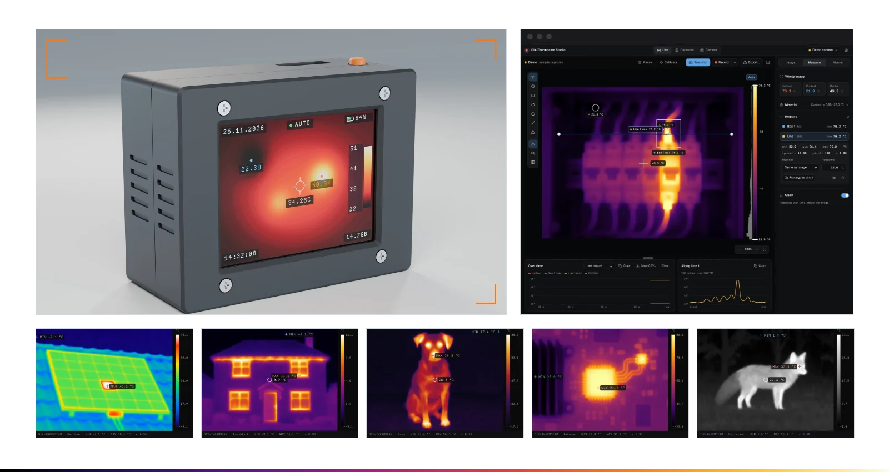
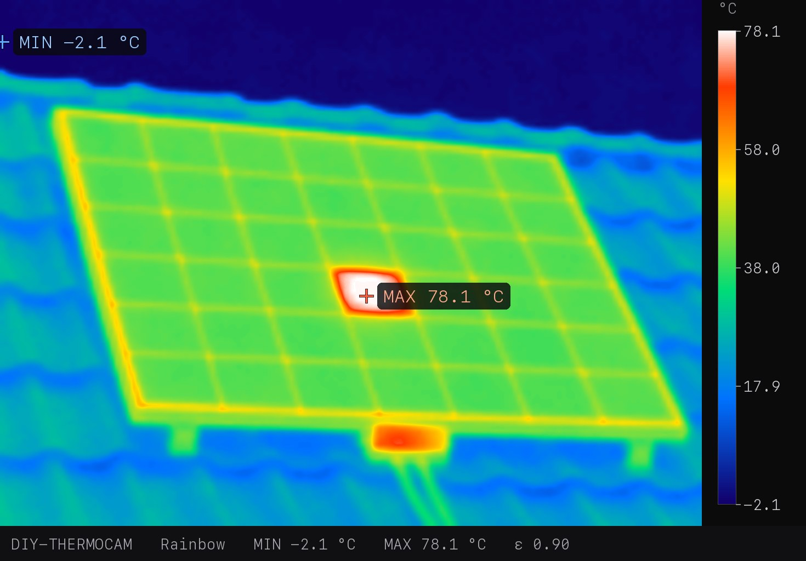
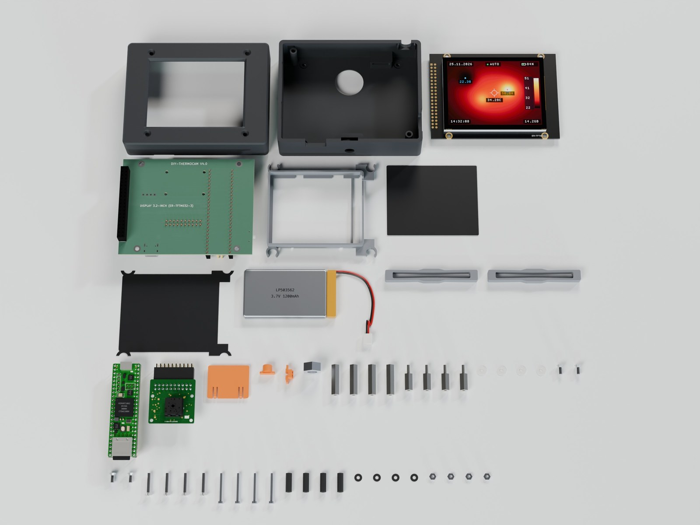
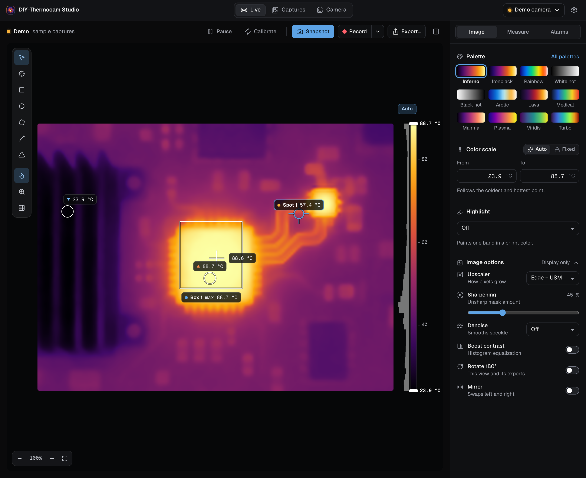

<div align="center">


<h1>DIY-Thermocam<br><sub>Build your own thermal camera</sub></h1>

**A thermal camera that knows the temperature of every pixel. Every file to build it is public.**<br>
Two ready-made boards, a FLIR Lepton and a printed case, put together with screwdrivers. No soldering.

<a href="https://github.com/maxritter/diy-thermocam/releases"></a>
<a href="https://github.com/maxritter/diy-thermocam/releases"></a>
<a href="https://github.com/maxritter/diy-thermocam"></a>
<a href="LICENSE"></a>

<p>
  <a href="#build-one">Build</a> •
  <a href="https://www.diy-thermocam.net/docs/partlist/">Parts list</a> •
  <a href="docs/">Docs</a> •
  <a href="https://www.diy-thermocam.net">Website</a> •
  <a href="CHANGELOG.md">Changelog</a>
</p>

<p>
  <a href="https://github.com/maxritter/diy-thermocam/releases/latest"><b>Download Studio</b></a>&nbsp;&nbsp;
  <picture>
    <source media="(prefers-color-scheme: dark)" srcset="website/public/images/brand/os-marks-dark.svg">
    
  </picture>
</p>

<a href="https://www.diy-thermocam.net/film/diy-thermocam-v4.mp4"></a>

<picture>
  <source media="(prefers-color-scheme: dark)" srcset="website/public/images/brand/readme-hero-dark.webp">
  
</picture>

<sub>V4 is experimental: its boards and case haven't been tested on a real camera yet. A V3 runs firmware 4.0 and Studio today.<br>The thermal pictures are example scenes, rendered the way Studio exports them.</sub>

</div>

---

## What you get

| On the camera | In Studio | In every capture |
| :---: | :---: | :---: |
|  |  |  |
| A 3.2-inch touchscreen, 19 colour palettes and up to 96 measured spots. | Boxes, spots and lines on the live image. Record, and export MP4 or TIFF. | The temperature of every pixel, so you can measure again later. |

| Sensor | Range | Battery | Parts |
| --- | --- | --- | --- |
| FLIR Lepton 3.5 or 3.1R, 160 × 120 pixels | −10 to +450 °C, under 50 mK | 2.5–3.5 hours on the 1200 mAh LiPo, up to 6 with a 2000 mAh cell | About $293, or $121 without the sensor |

## Build one

| 1. Order the parts | 2. Put it together | 3. Install Studio |
| :---: | :---: | :---: |
|  |  |  |
| The [parts list](https://www.diy-thermocam.net/docs/partlist/) finds shops for your country and adds up the prices. | 15 steps with two screwdrivers and two nut drivers: the [build guide](docs/building-instructions.md). | Studio also installs the firmware: **Camera › Update firmware…** |

Firmware 4.0 runs on V3 and V4 cameras (Teensy 4.1). V1 and V2 stay on [firmware 2.4.8](https://github.com/maxritter/diy-thermocam/releases/tag/2.4.8). On Linux, [allow USB access](docs/manual.md#linux-usb-permissions) first.

## Reference

<details>
<summary><b>Build from source</b></summary>

Firmware, with [Arduino CLI](https://github.com/arduino/arduino-cli). [`firmware/README.md`](firmware/README.md) explains flashing on Windows, macOS and Linux.

```bash
cd firmware && arduino-cli compile
```

Studio ([Tauri v2](https://github.com/tauri-apps/tauri), Rust and React):

```bash
cd app && bun install && bun run build
```

</details>

<details>
<summary><b>Tests and checks</b></summary>

```bash
# Firmware host unit tests, UI simulator tests and screenshots
make -C firmware/tests_host test
make -C firmware/sim test
make -C firmware/sim screenshots

# Hardware regression suite on a connected camera (45 tests)
cd firmware/test && pytest --baseline baseline-3.0.4.json

# Studio
cd app && cargo clippy --workspace --all-targets -- -D warnings && cargo test --workspace && bun run lint && bun test

# Website
cd website && bun run lint && bun run check && bun run build && bun scripts/verify-dist.mjs

# Parts list, KiCad ERC/DRC and enclosure geometry
python3 hardware/bom/validate_bom.py
kicad-cli sch erc --severity-error --exit-code-violations hardware/pcb/diy-thermocam-v4.0.kicad_sch
kicad-cli pcb drc --refill-zones --severity-error --exit-code-violations hardware/pcb/diy-thermocam-v4.0.kicad_pcb
cd hardware/enclosure/cad && uv run --extra dev --python 3.12 pytest
```

Turn on the pre-commit hook with `git config core.hooksPath .githooks`. Measured on a real V3: 8.77 frames per second over USB, 0.26 ms median command latency and 9.20 MB/s reading the microSD card ([protocol v2](docs/protocol-v2.md)). The old Windows and Python tools are archived at tag [`3.0.4`](https://github.com/maxritter/diy-thermocam/tree/3.0.4/software).

</details>

<details>
<summary><b>What's in this repository</b></summary>

| Folder | Contents |
| --- | --- |
| [`firmware/`](firmware/) | Teensy 4.1 firmware in C++17, host unit tests, UI simulator, hardware test suite |
| [`app/`](app/) | Studio for macOS, Windows and Linux |
| [`hardware/pcb/`](hardware/pcb/) | KiCad 10 boards, Gerbers, assembly files and 3D model |
| [`hardware/enclosure/`](hardware/enclosure/) | [build123d](https://github.com/gumyr/build123d) CAD for the printed shell and the laser-cut acrylic case, and the renders |
| [`hardware/bom/`](hardware/bom/) | The parts list as `bom.csv`, its validator and the order guide |
| [`docs/`](docs/) · [`website/`](website/) | Manuals, protocol specs and [www.diy-thermocam.net](https://www.diy-thermocam.net) |

</details>

## License

You may build DIY-Thermocam for yourself, study it, change it and share your changes, for personal, educational and other non-commercial use. Selling boards, kits, cameras or the software needs a commercial license.

| Part | License |
| --- | --- |
| Hardware and documentation | CC BY-NC-SA 4.0 |
| DIY-Thermocam Studio and the website | PolyForm Noncommercial 1.0.0 |
| Firmware | GPL v3.0 |

The DIY-Thermocam name and logo are trademarks ([TRADEMARKS.md](TRADEMARKS.md)). Releases up to v4.0.0 keep the GPL terms they shipped with. Details: [LICENSE](LICENSE).

Created by [Max Ritter](https://maxritter.net) · [Contributing](CONTRIBUTING.md) · [Changelog](CHANGELOG.md)

Thanks to [Joe-C](http://joe-c.de/pages/projekte/thermovision.php) for ThermoVision, a Windows viewer for `.DAT` files, and to [helmarw](https://github.com/helmarw/DIY-Thermocam/tree/master/Enclosure/3.0b), whose community enclosure inspired details of the printed shell.
