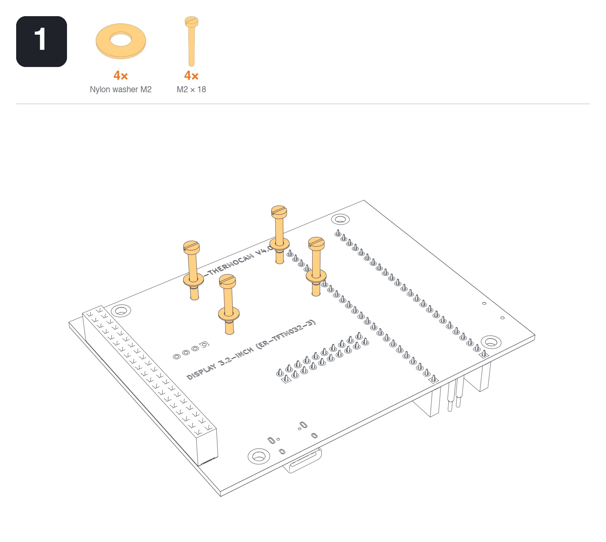
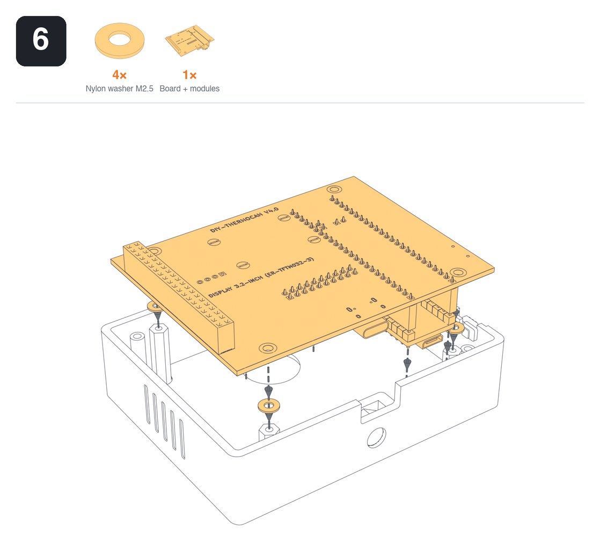
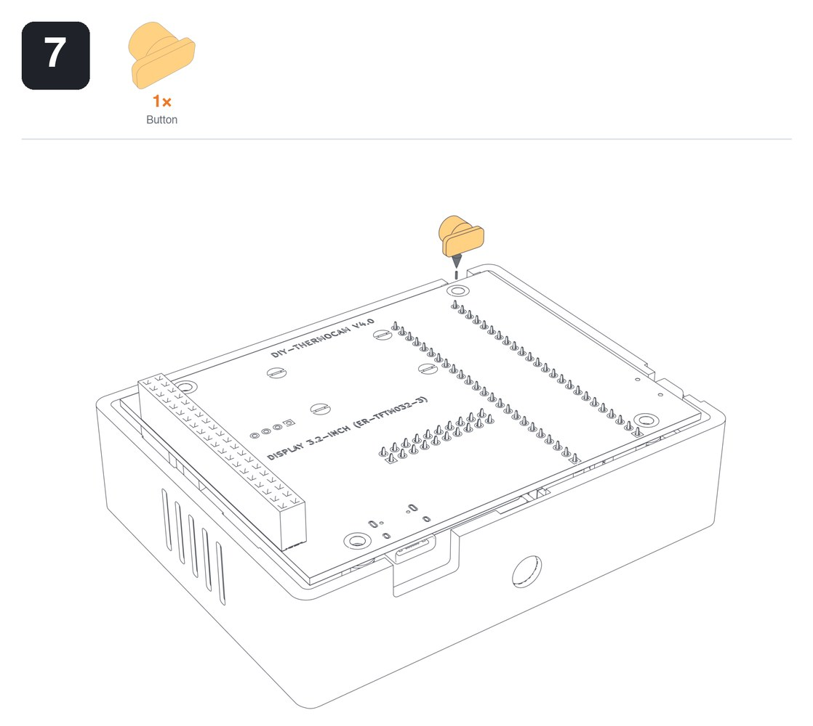
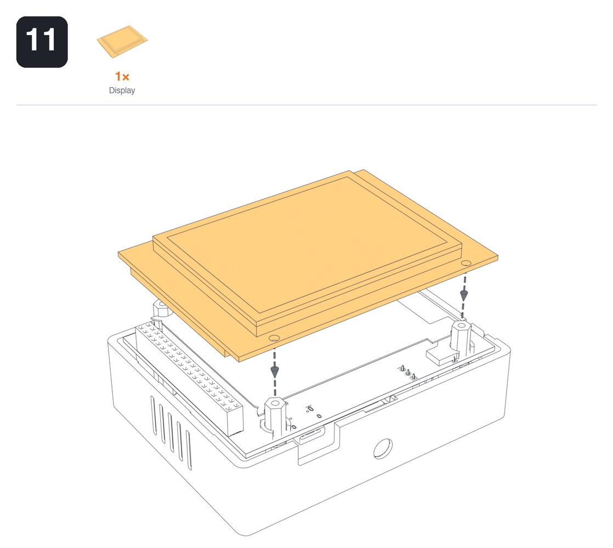
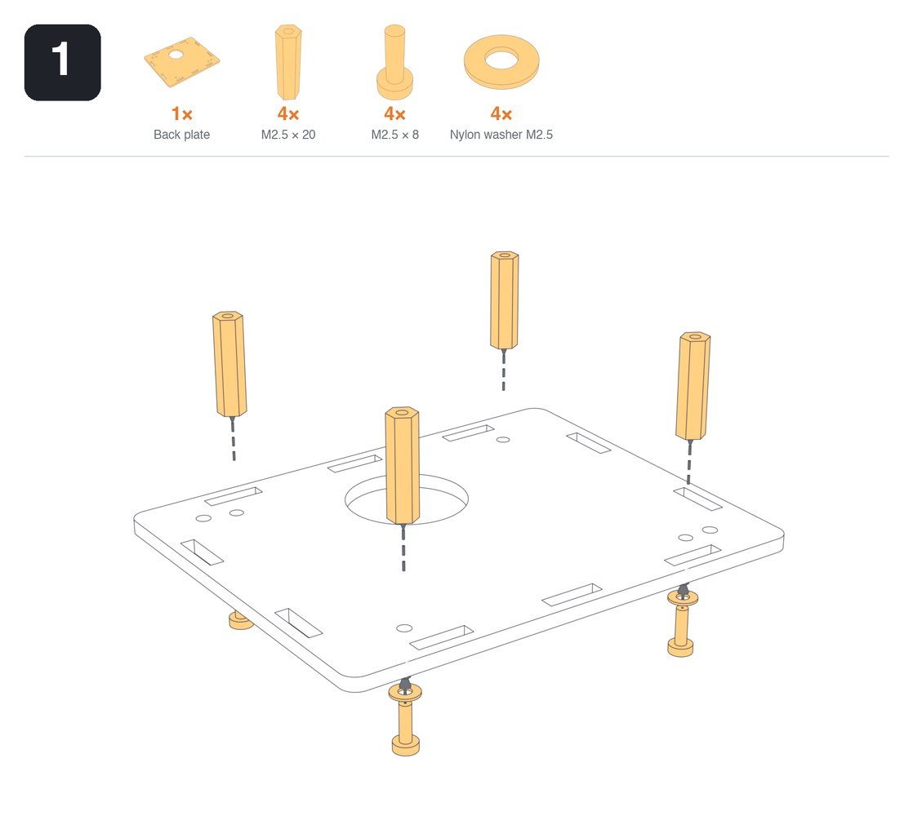
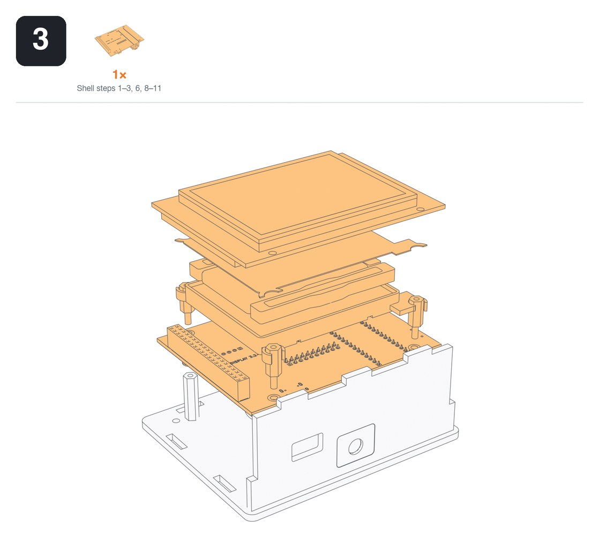

# Build guide

Turn the two assembled boards, four modules and a printed shell into a working camera. In each picture, the parts you add are orange and listed at the top.

> **V4 is experimental and still in development.** The V4 board and shell haven't been built and tested on a real camera yet. You're welcome to try them, but there's no guarantee they work. Already have a V3? It can update its firmware and use Studio today.

## What you need

| Part | Where |
| --- | --- |
| V4 main board and Lepton carrier, both assembled *Gerbers, BOM and placement files in hardware/pcb/fab* | JLCPCB, Seeed Fusion or PCBWay |
| Shell, 8 printed parts *Or a laser-cut 3 mm acrylic case plus 7 small printed parts* | Your printer, JLC3DP, PCBWay, Seeed Fusion or Craftcloud; acrylic from Formulor, Snijlab, Ponoko, SendCutSend or Elecrow |
| Battery floor and lid *2 bare FR4 boards, 0.6 and 0.4 mm; Gerbers in hardware/enclosure/exports/fr4* | JLCPCB or any PCB maker |
| Teensy 4.1 with headers | DigiKey |
| FLIR Lepton 3.5 *500-0771-01, radiometric, 57°. Or the 3.1R for 95°* | DigiKey or Mouser |
| 3.2" touch display *ER-TFTM032-3: 4-wire SPI, 5 V, resistive touch, pin header* | BuyDisplay |
| LiPo, Adafruit 258 *1200 mAh, protected, 5 × 34 × 62 mm, JST-PH plug. More runtime: a 505060 2000 mAh cell, at most 5.0 mm thick; confirm its JST-PH plug and polarity first* | Adafruit or DigiKey; the 505060 from ampul.eu |
| Standoffs, screws and nuts *8 metal M2.5 standoffs, 8 countersunk M2.5 screws, nylon washers, the Lepton mount* | ettinger.de |
| USB-C cable, microSD card, 1/4"-20 hex nut *Any 16–32 GB Class 10 card; the nut from a hardware store* | DigiKey, any shop |
| Tools and threadlocker *PH1 Phillips screwdriver, 2 mm flat screwdriver, 4 mm nut driver, 5 mm nut driver no more than 7.5 mm across, fine tweezers; medium-strength removable threadlocker such as Loctite 243* | Any hardware store |

[Open the parts list](https://www.diy-thermocam.net/docs/partlist/) for prices, links and the files each fab needs.

## 1. Lepton screws

From the display side, push the four M2 × 18 screws through the Lepton holes, each with a nylon M2 washer under its head. Put a strip of tape over the four heads so the screws stay in when you turn the board over.

## 2. Lepton

Turn the board over. Slide a 12 mm sleeve onto each screw. Snap the Lepton into the carrier's socket, then lower the carrier onto the screws so its header pins go into J2. Press on the carrier next to the header, never on the Lepton. Put a small drop of threadlocker on each screw tip, keeping it off the Lepton, and tighten the four M2 nuts with a 4 mm nut driver until snug. The carrier goes on before the Teensy, because the nut driver needs the Teensy's place.

Have a multimeter? Check the carrier's supplies before the Lepton goes in the first time: fit the carrier alone with the nuts finger-tight, connect USB-C, switch on, and measure across the capacitors marked 1.2V, 2.8V and 3.0V ([PCB README](../hardware/pcb/README.md#first-power-up), step 6). Then switch off, take the carrier off and continue as above.

## 3. Teensy

Push the Teensy into its two sockets on the back of the board, next to the carrier, USB end toward the bottom edge. Leave its five inner pads empty: spring pins on the board press on them. If pins are soldered there, cut them flush underneath first; never force the Teensy down. The microSD card goes in last, at step 14.

## 4. Rear standoffs

Stand the four 20 mm standoffs in their seats in the back shell and screw them on from outside with the M2.5 × 6 countersunk screws, holding each standoff with the 5 mm nut driver.

## 5. Tripod nut and slider

With the shell open side up, drop the 1/4"-20 nut into its pocket and push it home past the two ribs with a screwdriver; they hold it in line with the tripod hole. Drop the switch slider into its slot.

## 6. Battery and board

Check the LiPo's + and − against the marking at J4, then plug it into J4 on the back of the board. Lay its wires round the right board edge, level with J4: J4 is out of reach once the board is in. Put a nylon M2.5 washer on each standoff; the washers keep the standoffs' corners off the button pads on the back of the board. Lower the board onto them, holding the LiPo above it, and line the slider up with the slide switch so the switch drops into its fork.

## 7. Capture button

Drop the capture button into its slot in the top wall, flange inside, so the flange slides down past the board edge. Press it: you should feel the switch click.

## 8. Middle standoffs

Screw the four 11 mm standoffs through the board into the standoffs below, using the 5 mm nut driver.

## 9. Cradle and floor

Lower the cradle over the four 11 mm standoffs until its feet stand on the board, with the wire gap in its right wall. Drop the 0.6 mm FR4 floor into the cradle; it rests on the ledge at the bottom.

## 10. Battery

Lay a battery spacer against each long wall of the cradle. Press the LiPo down between them so its wires come out at the corner nearest the gap in the right wall, and lead them straight out through the gap. Fold the spare lead flat on the board beside the cradle. Lay the 0.4 mm FR4 lid on the cradle so its four rounded tabs sit against the standoffs. A 50 × 60 mm cell goes in without the spacers.

## 11. Display

Press the display onto its 2 × 20 header. It rests on the 11 mm standoffs.

## 12. Front shell

Fit the front shell. Its four bosses press the display onto the standoffs. Tighten the four M2.5 × 14 countersunk screws with a PH1 Phillips screwdriver until snug.

## 13. Lens cap

Slide the cap into its track from the top. It clicks at the open and closed positions.

## 14. microSD card

Push the card through the slot in the top edge, contacts facing the Teensy, with fine tweezers until it stops. Its end sits about 9 mm inside the shell (11 mm in the acrylic case). The Teensy's socket holds the card by friction and doesn't click; pull it out the same way. Take the card out before you ever lift the board out of the case: a fitted card catches on the card guide.

## 15. Firmware

Connect the camera with a USB-C cable and switch it on. Open [Studio](https://www.diy-thermocam.net/software/#download), go to Updater and choose the firmware file from the [latest release](https://github.com/maxritter/diy-thermocam/releases/latest). Studio restarts the camera when it is done.

<!-- studio-download -->

## Acrylic case

The acrylic case holds the same board stack between six black acrylic plates. Besides the sheet, it needs 7 small printed parts (the battery cradle with its 2 battery spacers, the tripod mount, 2 display spacer bars and the microSD chute) and the two FR4 battery boards. Pan head screws with nylon washers replace the countersunk screws.

### 1. Back plate

Screw the four 20 mm standoffs to the back plate with the M2.5 × 8 pan head screws, a nylon washer under each head, holding each standoff with the 5 mm nut driver.

### 2. Bottom plate and tripod mount

Slot the bottom plate into the back plate. Slide the 1/4"-20 nut into the tripod mount from its back face until it stops; two ribs hold it there. Set the mount into the hole in the bottom plate, which then keeps the nut in.

### 3. Board stack

Follow shell steps 1–3, 6 and 8–11 (the acrylic case has no slider; its switch key goes in at step 5). The board slides down past the tripod mount's fin, which then holds the mount in place.

### 4. Top plate

From the inside, push the button key into the small slot in the top plate. Hold it there and slot the top plate straight down into the back plate. Press the key: you should feel the switch click.

### 5. Side plates

From the inside, push the switch key into the slot in the right plate. Slot the right plate straight down so the key's fork goes over the slide switch, then slot in the left plate.

### 6. Front plate

Lay the two spacer bars on the display's mounting holes, put the front plate on and tighten the M2.5 × 14 pan head screws, a nylon washer under each head.

### 7. microSD chute

Push the chute into the slot in the top plate until it clicks. Insert the card through it with fine tweezers until it stops; the socket doesn't click.

Then install the firmware as in step 15.
