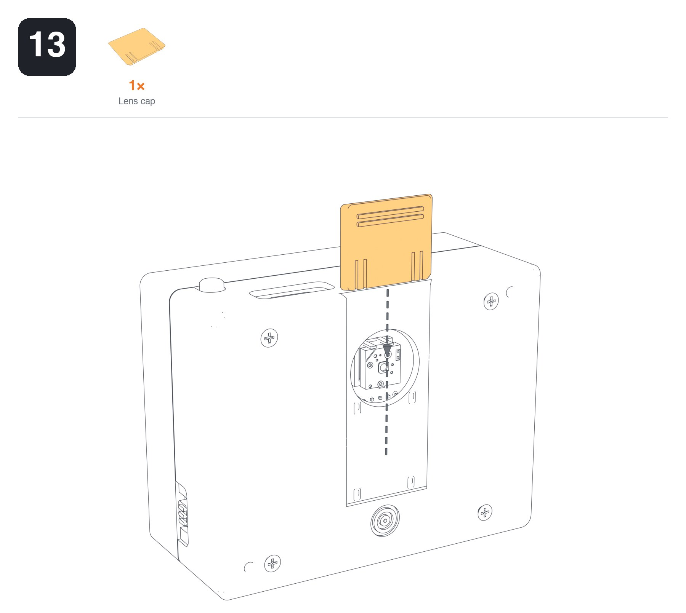
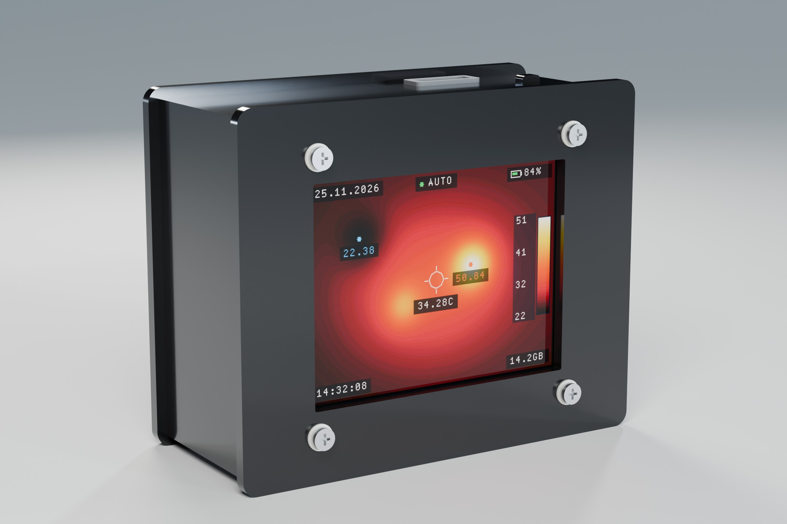
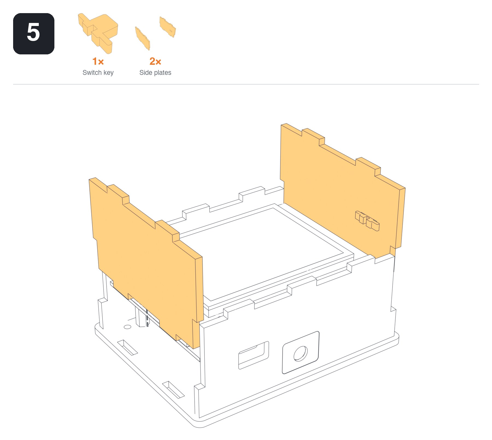
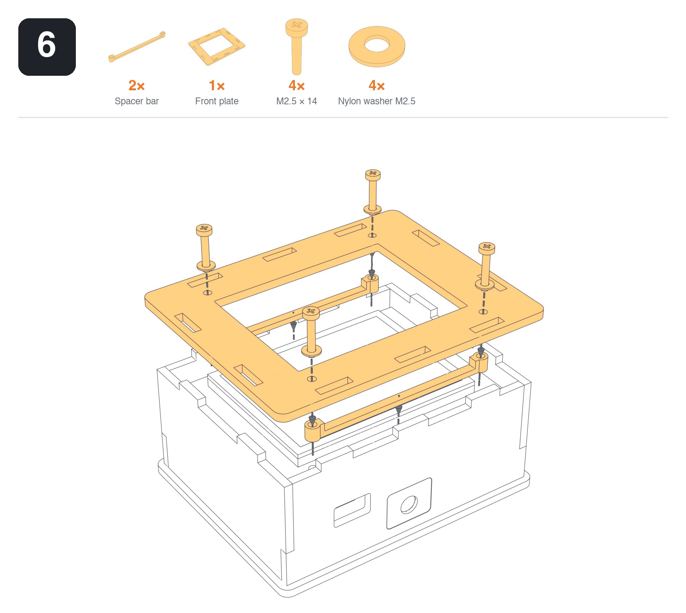
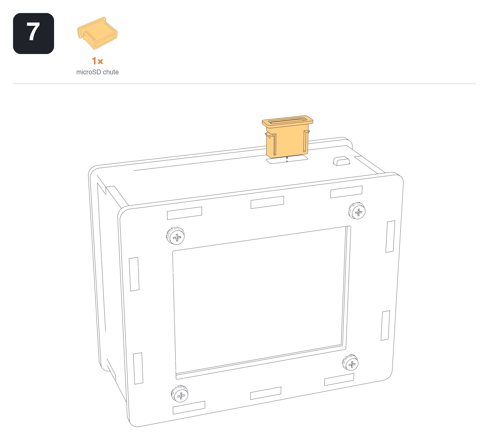

# Build guide

Turn the assembled board, four modules and a printed shell into a working camera. In each picture, the parts you add are orange.

> **V4 is experimental.** Its board and shell are not yet tested on a real camera. A V3 can run the new firmware and Studio today.

## What you need

| Part | Where |
| --- | --- |
| V4 main board, assembled *Gerbers, BOM and placement files in hardware/pcb/fab* | JLCPCB, Seeed Fusion or PCBWay |
| Shell, 8 printed parts *Or a laser-cut 3 mm acrylic case plus 7 small printed parts* | Your printer, JLC3DP, PCBWay, Seeed Fusion or Craftcloud; acrylic from Formulor, Snijlab, Ponoko, SendCutSend or Elecrow |
| Battery floor and lid *2 bare FR4 boards, 0.6 and 0.4 mm; Gerbers in hardware/enclosure/exports/fr4* | JLCPCB or any PCB maker |
| Teensy 4.1 with headers | DigiKey |
| FLIR Lepton 3.5 *500-0771-01, radiometric, 57°. Or the 3.1R for 95°* | DigiKey or Mouser |
| FLIR Lepton Breakout Board V2.0 + right-angle 2×10 female header *Teledyne FLIR 250-0577-00 (Rev R200) and Sullins PPPC102LJBN-RC (3.15 mm tails)* | DigiKey (or Mouser for the breakout) |
| 3.2" touch display *ER-TFTM032-3: 4-wire SPI, 5 V, resistive touch, pin header* | BuyDisplay |
| LiPo, Adafruit 258 *1200 mAh, protected, 5 × 34 × 62 mm, JST-PH 2.0 mm plug. Or a 505060 2000 mAh cell (Amazon / ampul.eu): max 62 × 50.5 mm, ≤ 5.0 mm thick, built-in protection, ≥ 500 mA charge rating, JST-PH 2.0 mm plug, ≥ 50 mm lead, check `+` on J4 pin 1* | Adafruit, ampul.eu or Amazon |
| Standoffs, screws and nuts *8 metal M2.5 standoffs, 8 countersunk M2.5 screws, nylon washers, the Lepton mount* | ettinger.de |
| 1/4"-20 hex nut, USB-C cable, microSD card *Stainless 1/4"-20 nut (HNSS 025 20) from DigiKey; any 16–32 GB Class 10 card* | DigiKey, any shop |
| Tools and threadlocker *PH1 Phillips screwdriver, 2 mm flat screwdriver, 4 mm nut driver, 5 mm nut driver no more than 7.5 mm across, fine tweezers; medium-strength removable threadlocker such as Loctite 243* | Any hardware store |

[Open the parts list](https://www.diy-thermocam.net/docs/partlist/) for prices, links and the files each fab needs.

## 1. Lepton screws

- From the display side, push four M2 × 18 screws through the Lepton holes.
- Nylon M2 washer under each head.
- Tape over the heads to hold them.

## 2. Lepton

- Turn the board over. Slide three 0.3 mm nylon M2 washers (`003.03.010`) and one 12 mm sleeve onto each screw (= 12.9 mm spacing, so the right-angle header clears `J2` across tolerances).
- Check the FLIR Breakout Board V2.0 label: it should be **Rev R200** (older Rev R120 boards had D1 reversed and cannot power up from `J2` pin 2).
- Snap the Lepton into the FLIR Breakout Board V2.0.
- Push the right-angle 2 × 10 female header (`PPPC102LJBN-RC`) firmly onto the breakout's header, legs pointing toward the main board (same side as the jumpers).
- Lower the breakout onto the screws, guiding the adapter's legs into `J2`. Press beside the header, never on the Lepton.
- Threadlocker on each screw tip, kept off the Lepton.
- Tighten the four 1.2 mm M2 thin nuts (`002.09.012`) with the 4 mm nut driver until snug.
- Fit the breakout before the Teensy: the nut driver needs that space.

## 3. Teensy

- Push the Teensy into its two back-side sockets, USB end toward the bottom edge.
- Leave its five inner pads empty: spring pins press on them.
- Pins soldered there? Cut them flush first. Never force the Teensy.

## 4. Rear standoffs

- Stand the four 20 mm standoffs in their seats in the back shell.
- Screw them on from outside with M2.5 × 6 countersunk screws.
- Hold each with the 5 mm nut driver.

## 5. Tripod nut and slider

- Push the 1/4"-20 nut into its pocket, past the two ribs, with a screwdriver.
- Drop the switch slider into its slot.

## 6. Battery and board

- Match the LiPo's + and − to the marking at J4, then plug it in.
- Lay its wires round the right board edge, level with J4. You can't reach J4 later.
- Put a nylon M2.5 washer on each standoff to protect the button pads.
- Lower the board onto them, holding the LiPo above.
- The slide switch must drop into the slider's fork.

## 7. Capture button

- Drop the button into the top-wall slot, flange inside, past the board edge.
- Press it: the switch should click.

## 8. Middle standoffs

- Screw four 11 mm standoffs through the board into those below, with the 5 mm nut driver.

## 9. Cradle and floor

- Lower the cradle over the 11 mm standoffs onto the board, wire gap to the right.
- Drop the 0.6 mm FR4 floor onto its bottom ledge.

## 10. Battery

- Put a spacer against each long cradle wall.
- Press the LiPo in between, wires at the corner nearest the gap, then out through it.
- Fold the spare lead flat beside the cradle.
- Lay the 0.4 mm FR4 lid on top, rounded tabs against the standoffs.
- A 50 × 60 mm cell needs no spacers.

## 11. Display

- Press the display onto its 2 × 20 header. It rests on the 11 mm standoffs.

## 12. Front shell

- Fit the front shell over the display.
- Tighten the four M2.5 × 14 countersunk screws with the PH1 screwdriver until snug.

## 13. Lens cap

- Slide the cap into its track from the top. It clicks open and closed.

## 14. microSD card

- With tweezers, push the card into the top slot, contacts toward the Teensy.
- It stops about 9 mm inside (11 mm in the acrylic case). No click.
- Pull it out the same way.
- Remove the card before lifting the board out, or it catches.

## 15. Firmware

- Connect USB-C to a port or powered hub rated **1.5 A or more** (the camera's USB input limit is 1.3 A nominal, up to 1.45 A worst case; a 500 mA hub port can cut out) and switch the camera on.
- In [Studio](https://www.diy-thermocam.net/software/#download), open **Camera › Update firmware…**.
- Choose the file from the [latest release](https://github.com/maxritter/diy-thermocam/releases/latest). Studio restarts the camera.

<!-- studio-download -->

## Acrylic case

The same board stack between six black acrylic plates.

- Also needs 7 printed parts: cradle, 2 battery spacers, tripod mount, 2 display spacer bars, microSD chute.
- Uses the same two FR4 battery boards.
- Pan head screws with nylon washers replace the countersunk screws.

### 1. Back plate

- Screw the four 20 mm standoffs on with M2.5 × 8 pan head screws.
- Nylon washer under each head. Hold each standoff with the 5 mm nut driver.

### 2. Bottom plate and tripod mount

- Slot the bottom plate into the back plate.
- Slide the 1/4"-20 nut into the tripod mount's back face until it stops.
- Set the mount into the bottom plate's hole.

### 3. Board stack

- Follow shell steps 1–3, 6 and 8–11, without the slider.
- Slide the board down past the tripod mount's fin.

### 4. Top plate

- From inside, push the button key into the top plate's small slot.
- Hold it and slot the top plate straight down.
- Press the key: the switch should click.

### 5. Side plates

- From inside, push the switch key into the right plate's slot.
- Slot the right plate down, the key's fork over the slide switch.
- Slot in the left plate.

### 6. Front plate

- Lay the two spacer bars on the display's mounting holes.
- Fit the front plate with M2.5 × 14 pan head screws and nylon washers.

### 7. microSD chute

- Push the chute into the top plate's slot until it clicks.
- Insert the card through it with tweezers until it stops.

Then install the firmware as in step 15.
