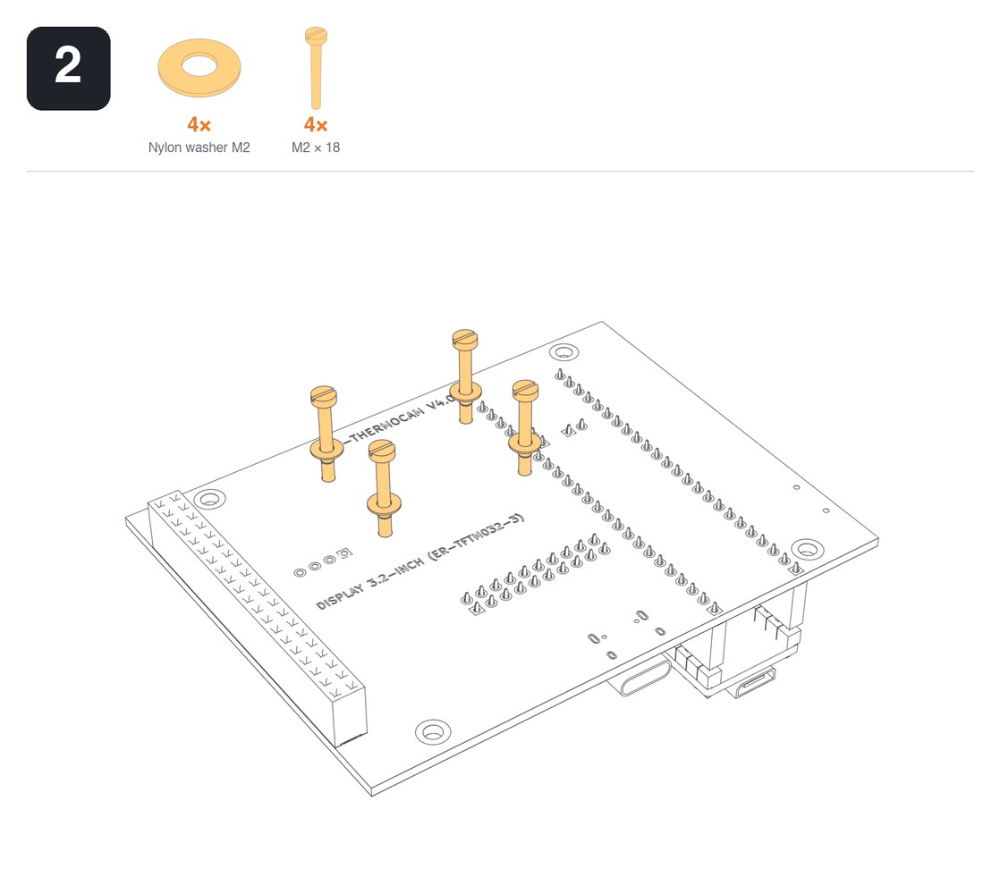
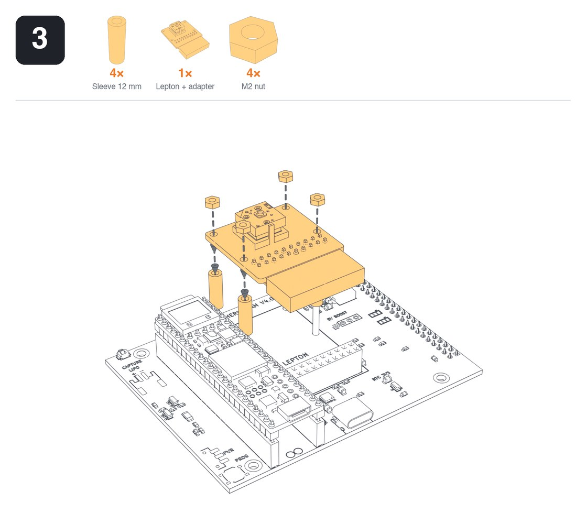
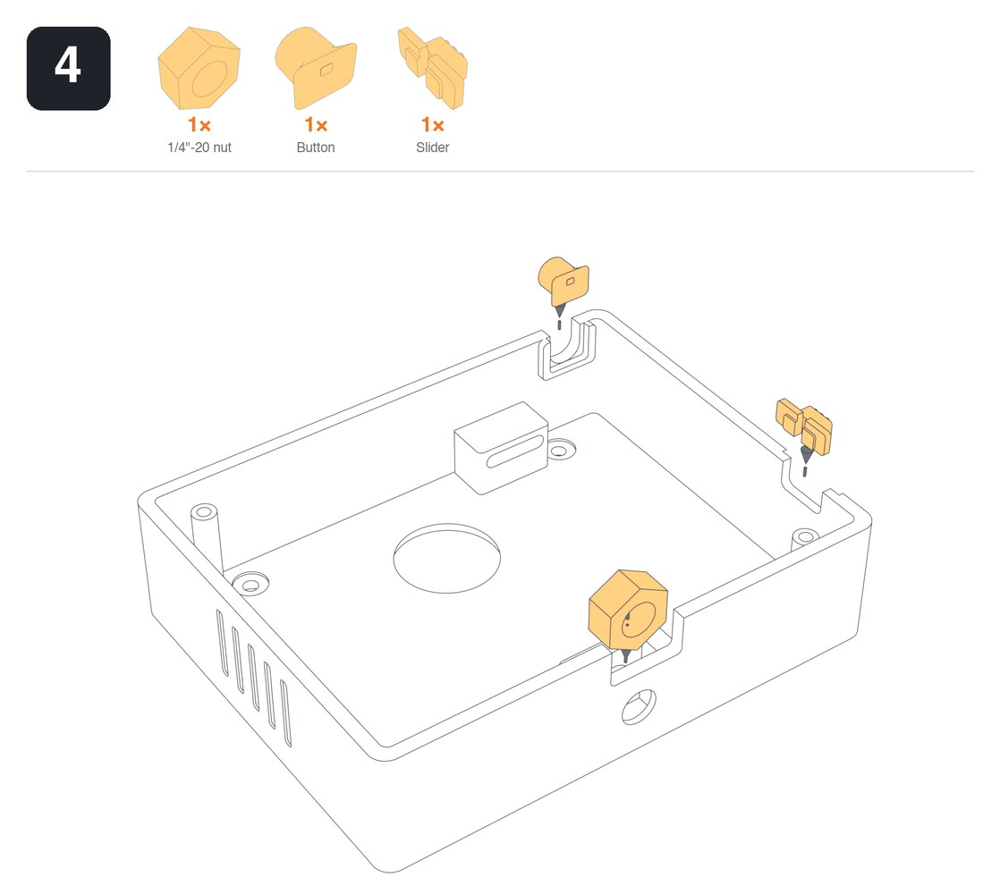
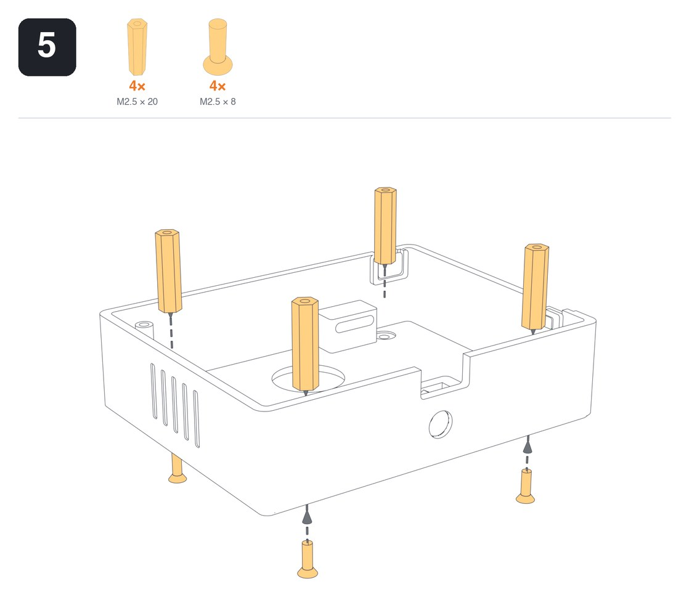
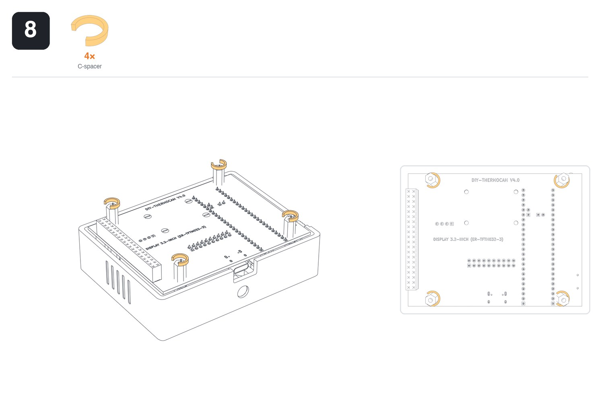
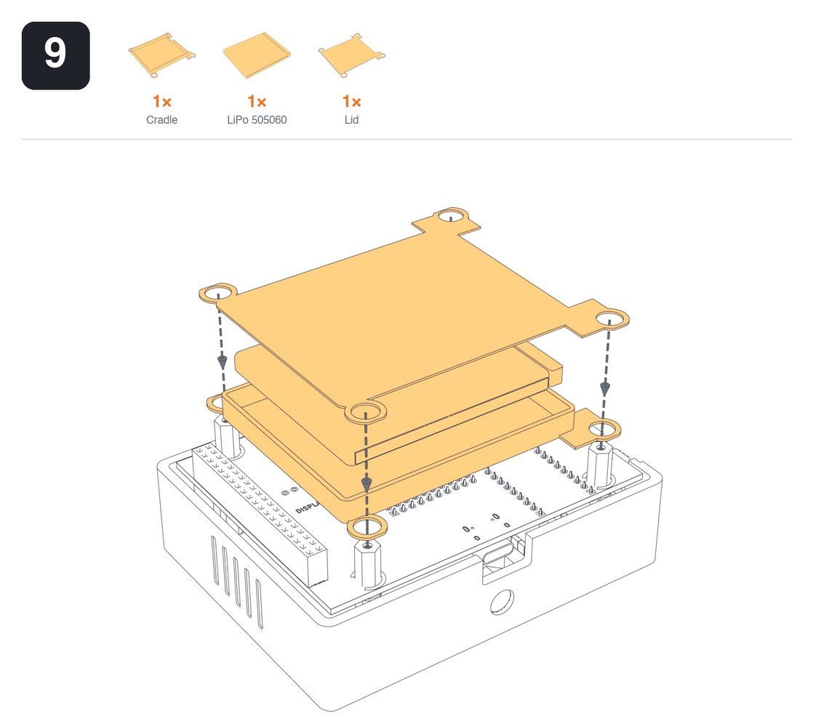
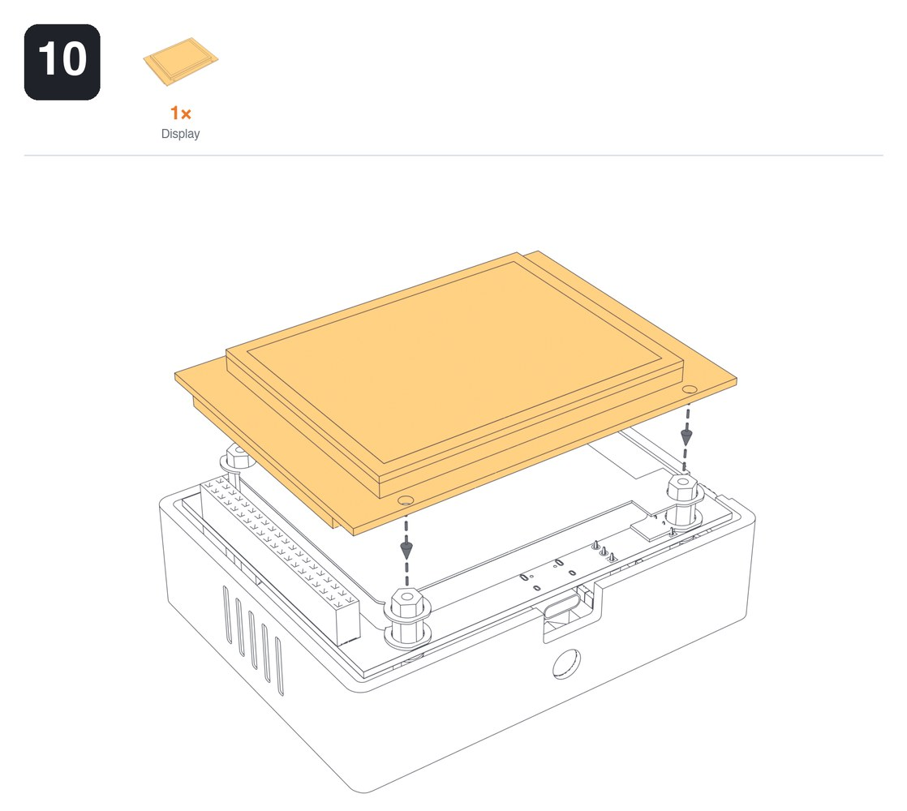
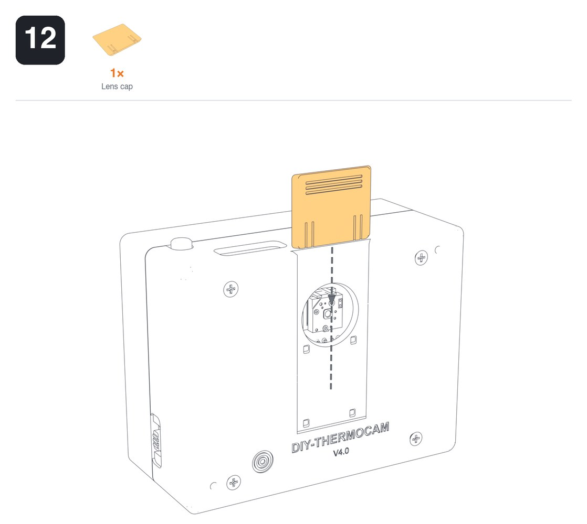
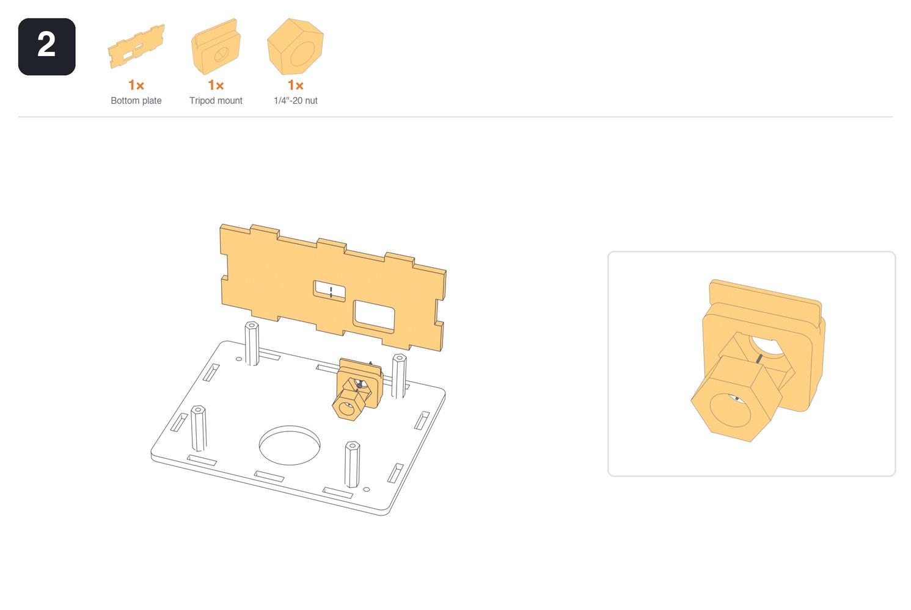
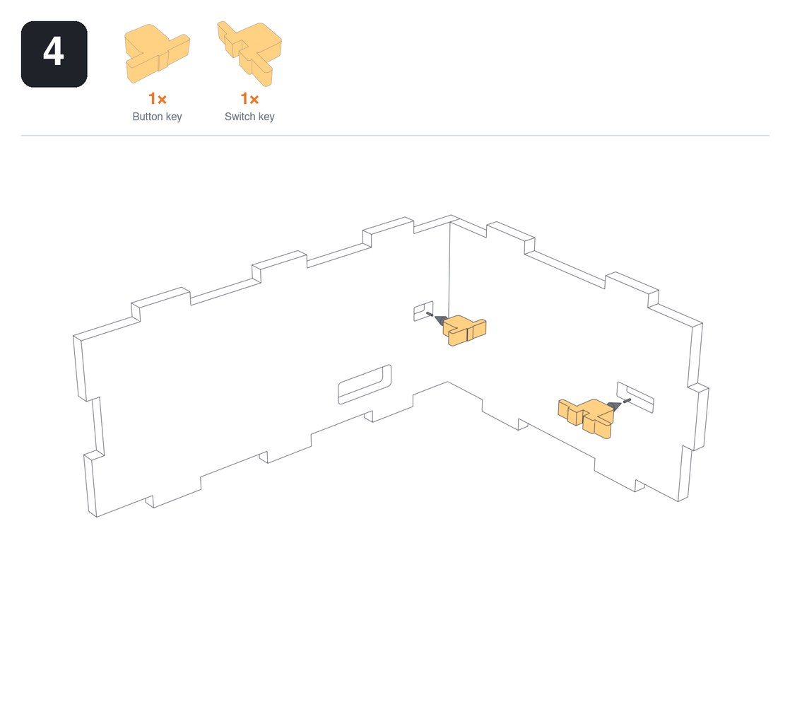

# Build guide

Turn the assembled board, four modules and a printed shell into a working camera. In each picture, the parts you add are orange and listed at the top.

> **V4 is experimental and still in development.** The V4 board and shell haven't been built and tested on a real camera yet. You're welcome to try them, but there's no guarantee they work. Already have a V3? It can update its firmware and use Studio today.

## What you need

| Part | Where |
| --- | --- |
| V4 board, assembled *Gerbers, BOM and placement files in hardware/pcb/fab* | JLCPCB, Seeed Fusion or PCBWay |
| Shell, 8 printed parts *Or a laser-cut 3 mm acrylic case plus 10 small printed parts* | Your printer, JLC3DP, PCBWay, Seeed Fusion or Craftcloud; acrylic from Formulor, Snijlab, Ponoko, SendCutSend or Elecrow |
| Teensy 4.1 with headers | DigiKey |
| FLIR Lepton 3.5 *500-0771-01, radiometric, 57°. Or the 3.1R for 95°* | DigiKey or Mouser |
| Lepton Breakout Board V2.0 *Teledyne FLIR 250-0577-00, not the PureThermal board* | DigiKey or Mouser |
| Right-angle 2×10 female header *Sullins PPPC102LJBN-RC, connects the breakout to the board* | DigiKey |
| 3.2" touch display *ER-TFTM032-3: 4-wire SPI, 5 V, resistive touch, pin header* | BuyDisplay |
| LiPo 505060, 2000 mAh *Protected, at most 5.0 mm thick, JST-PH plug* | ampul.eu; or the slimmer Adafruit 258 (1200 mAh) from Adafruit or DigiKey |
| Standoffs, screws and nuts *8 metal M2.5 standoffs, 8 countersunk M2.5 screws, nylon washers, the Lepton mount* | ettinger.de |
| USB-C cable, microSD card, 1/4"-20 hex nut *Any 16–32 GB Class 10 card; the nut from a hardware store* | DigiKey, any shop |

[Open the parts list](https://www.diy-thermocam.net/docs/partlist/) for prices, links and the files each fab needs.

## 1. Teensy

Insert the microSD card. Push the Teensy into its two sockets on the back of the board, USB end toward the bottom edge. Leave its five inner pads empty: spring pins on the board press on them. If pins are soldered there, cut them flush underneath first; never force the Teensy down.

## 2. Lepton screws

From the display side, push the four M2 × 18 screws through the Lepton holes, each with a nylon M2 washer under its head.

## 3. Lepton

Turn the board over. Slide a 12 mm sleeve onto each screw. Snap the Lepton into the breakout, plug the right-angle adapter onto the breakout's header, then lower the breakout onto the screws so the adapter's legs go into J2. Fit the four M2 nuts finger-tight.

## 4. Back shell

Slide the 1/4"-20 nut into its pocket from the open side. Drop the capture button and the switch slider into their slots.

## 5. Rear standoffs

Stand the four 20 mm standoffs in their seats and screw them on from outside with the M2.5 × 8 countersunk screws.

## 6. Board

Put a nylon M2.5 washer on each standoff, then lower the board onto them. The slide switch drops into the slider's fork.

## 7. Middle standoffs

Screw the four 11 mm standoffs through the board into the standoffs below.

## 8. C-spacers

Slip a C-spacer over each 11 mm standoff. Turn the gap toward the Teensy socket at the lower right and toward the capture button at the upper right.

## 9. Battery

Lay the cradle on the spacers and the LiPo in the cradle. Run the wires through the gap in the cradle's right wall and round the right board edge to J4 on the back. Check + and − against the marking and plug it in now: J4 is out of reach later. Put the lid on.

## 10. Display

Press the display onto its 2 × 20 header. It rests on the 11 mm standoffs.

## 11. Front shell

Fit the front shell. Its four bosses press the display onto the standoffs. Tighten the four M2.5 × 14 countersunk screws with a PH1 Phillips screwdriver until snug.

## 12. Lens cap

Slide the cap into its track from the top. It clicks at the open and closed positions.

## 13. Firmware

Connect the camera with a USB-C cable and switch it on. Open [Studio](https://www.diy-thermocam.net/software/#download), go to Updater and choose the firmware file from the [latest release](https://github.com/maxritter/diy-thermocam/releases/latest). Studio restarts the camera when it is done.

<!-- studio-download -->

## Acrylic case

The acrylic case holds the same board stack between six black acrylic plates. Besides the sheet, it needs 10 small printed parts: the battery cradle and lid, 4 C-spacers, the tripod mount, 2 display spacer bars and the microSD chute. Pan head screws with nylon washers replace the countersunk screws.

### 1. Back plate

Screw the four 20 mm standoffs to the back plate with the M2.5 × 8 pan head screws, a nylon washer under each head.

### 2. Bottom plate and tripod mount

Slot the bottom plate into the back plate. Press the 1/4"-20 nut into the tripod mount past its two lips, then set the mount into the hole in the bottom plate.

### 3. Board stack

Follow shell steps 1–3 and 6–10. The board slides down past the tripod mount's fin, which then holds the mount in place.

### 4. Keys

From the inside, push the button key into the small slot in the top plate and the switch key into the slot in the right plate.

### 5. Side plates

Hold each key in its slot and slot the top, left and right plates into the back plate. The switch key's fork goes over the slide switch.

### 6. Front plate

Lay the two spacer bars on the display's mounting holes, put the front plate on and tighten the M2.5 × 14 pan head screws, a nylon washer under each head.

### 7. microSD chute

Push the chute into the slot in the top plate until it clicks. Insert the card through it with tweezers.

Then install the firmware as in step 13.
