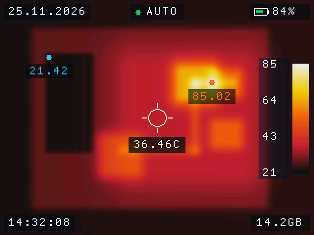
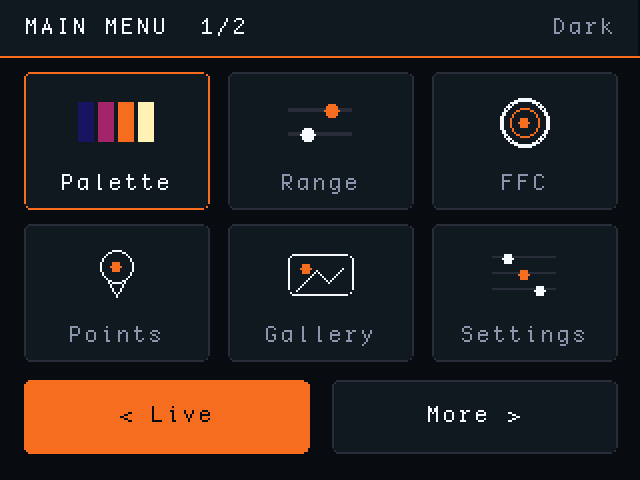
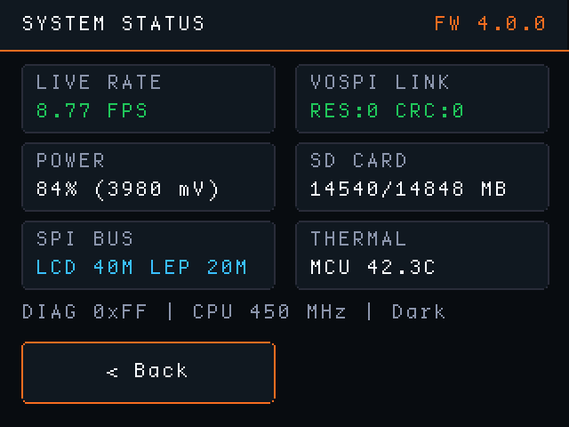
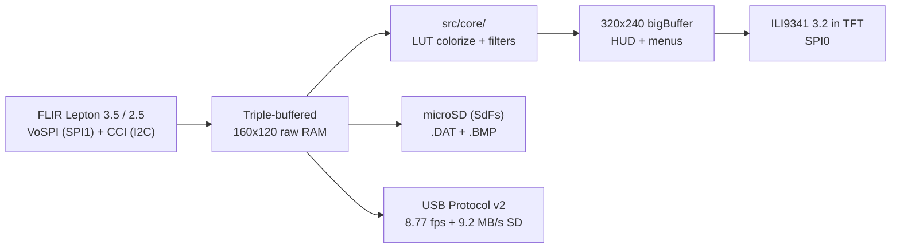

# DIY-Thermocam Firmware

Open-source C++17 firmware for **DIY-Thermocam V3 and V4** (**Teensy 4.1** + **FLIR Lepton 3.5 / 3.1R / 2.5**). Runs at 450 MHz to keep enclosure heat low while sustaining native **8.77 fps** live thermal viewing, zero-flicker RAM-composited HUDs, buffered microSD `.DAT` recording, and [USB Protocol v2](../docs/protocol-v2.md).

> **Hardware compatibility:** Firmware 4.0 targets **V3 and V4 (Teensy 4.1)** only. If you own an older **DIY-Thermocam V1 or V2 (Teensy 3.2 / 3.6)**, keep using [Firmware 2.4.8](https://github.com/maxritter/diy-thermocam/releases/tag/2.4.8). Every `.DAT` capture remains compatible across all revisions.

| Live View HUD | Main Menu (Dark) | System Status |
| :---: | :---: | :---: |
|  |  |  |

> **Just want to update your camera?** You do not need to compile anything. Download `firmware.hex` from [GitHub Releases](https://github.com/maxritter/diy-thermocam/releases) and flash it over USB in **DIY-Thermocam Desktop Studio** (Pro mode → **Updater**).

## Prerequisites and OS support

Flashing and building from source work on **Windows**, **macOS**, and **Linux** using [Arduino CLI](https://github.com/arduino/arduino-cli). You do not need Arduino IDE, Teensyduino, or PlatformIO.

| Operating system | Flash prebuilt `.hex` | Build & flash from source | Extra setup |
| --- | --- | --- | --- |
| **Windows 10 / 11** (x64) | Desktop Studio or PJRC Teensy Loader | `winget install ArduinoSA.CLI` | None (USB CDC & HalfKay HID drivers are built in) |
| **macOS 12+** (Apple Silicon & Intel) | Desktop Studio or PJRC Teensy Loader | `brew install arduino-cli` | None |
| **Linux** (x86_64 & ARM64) | Desktop Studio or PJRC Teensy Loader | `curl -fsSL https://raw.githubusercontent.com/arduino/arduino-cli/master/install.sh \| sh` | Install [PJRC udev rules](https://www.pjrc.com/teensy/00-teensy.rules) so flashing works without root |

**Hardware prerequisites:**
- A **data-capable USB cable** (USB-C; charge-only cables will not detect the Teensy).
- Camera **power switch turned ON** before flashing.
- **First flash on a brand-new blank Teensy 4.1:** press the physical **Program** button on the Teensy once. Every later update from Firmware 3.0.x or 4.0.x triggers the bootloader automatically over USB without opening the enclosure.

On Linux, install the PJRC udev rules once and reload them:

```sh
curl -fsSLO https://www.pjrc.com/teensy/00-teensy.rules
sudo cp 00-teensy.rules /etc/udev/rules.d/
sudo udevadm control --reload-rules && sudo udevadm trigger
```

## Build from source

`sketch.yaml` pins the exact board target (Teensy 4.1, 450 MHz, USB Serial + MTP Disk, `-O3`) and [Teensy core 1.62.0](https://github.com/PaulStoffregen/cores). The first compile downloads the core and ARM toolchain automatically.

```sh
cd firmware
arduino-cli compile
```

The first build takes a few minutes while toolchains download; incremental builds finish in ~10–30 seconds.

## Flash over USB

Connect the camera over USB, switch it **on**, and list connected serial ports:

```sh
arduino-cli board list
```

Look for the Teensy port—for example `COM5` (Windows), `/dev/ttyACM0` (Linux), `/dev/cu.usbmodem12345601` (macOS), or `usb:...`—then upload:

```sh
arduino-cli upload -p <port>
```

Teensy Loader writes the image and reboots the camera automatically. You can ignore the `discovery teensy:teensy-discovery not installed` notice printed in profile mode.

## Architecture



| Path | Responsibility |
| --- | --- |
| `src/core/` | Hardware-independent C++17 logic (Protocol v2 framing/CRC, thermal scaling, palette LUTs, `.DAT` codec) |
| `src/gui/` | On-device touchscreen UI: `mainmenu.cpp`, `templimitsmenu.cpp`, `settingsmenu.cpp`, `loadmenu.cpp`, `videomenu.cpp`, `livemode.cpp`, `gui.cpp`, `buttons.cpp`, `firststart.cpp` |
| `src/hardware/` | Teensy 4.1 drivers: Lepton VoSPI/CCI, ILI9341 display, XPT2046/FT6206 touch, [SdFat](https://github.com/greiman/SdFat) SDIO, battery ADC, USB Protocol v2/v1, MTP |
| `src/thermal/` | Live capture loop, frame pipeline, `.DAT`/`.BMP` save and gallery load |
| `sim/` | Native host UI simulator (`make test` for 18 interactive UI/touch/flicker tests, `make screenshots` for 2× PNGs) |
| `tests_host/` | Native C++17 unit tests for `src/core/` (runs without hardware) |
| `test/` | Live USB hardware regression suite using [pytest](https://github.com/pytest-dev/pytest) (45 automated v1 + v2 tests) |

## Automated tests

Run all host checks without hardware in under 2 seconds:

```sh
make -C firmware/tests_host test   # C++17 Protocol v2 & thermal core unit tests
make -C firmware/sim test          # 18 interactive UI, touch-glitch, and redraw-flicker tests
make -C firmware/sim screenshots   # Render all 12 on-device UI screens at 640x480
```

With a flashed camera connected over USB, run the 45-test live hardware regression suite (see [test/README.md](test/README.md)):

```sh
cd firmware/test
pytest --baseline baseline-3.0.4.json
```
