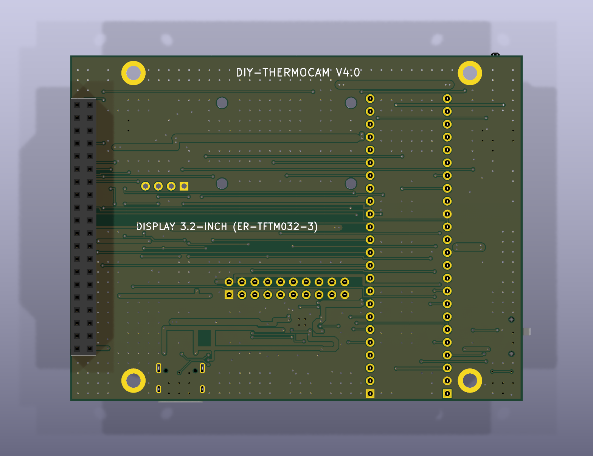
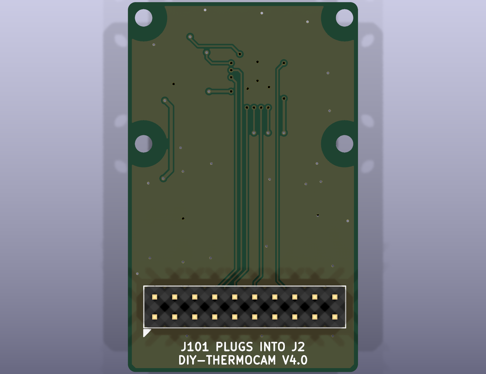
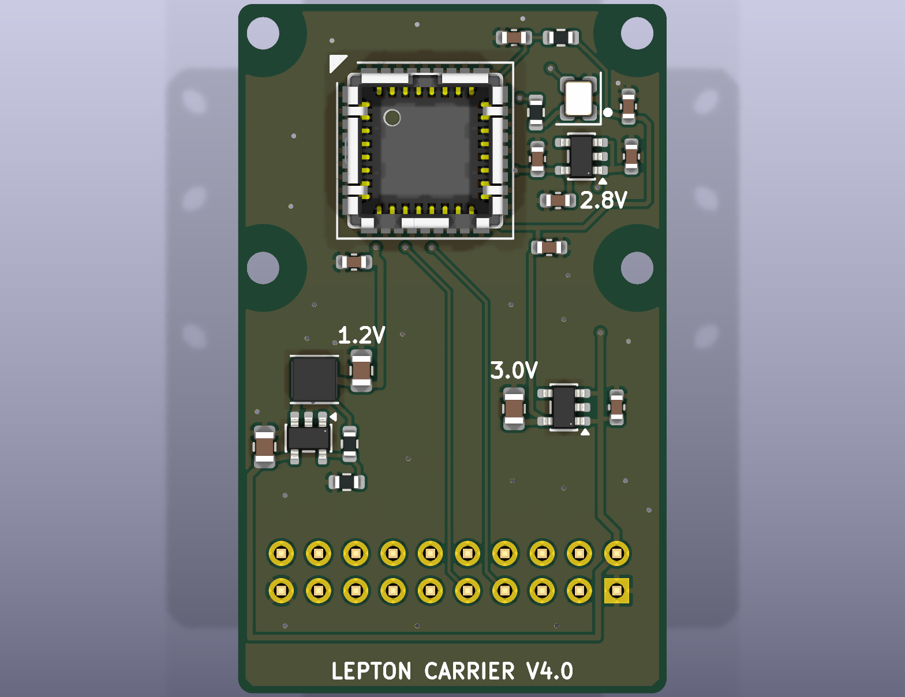

# DIY-Thermocam V4.0 PCBs

Two boards: the main board and a small Lepton carrier. A PCB manufacturer makes both and solders all parts on. You then plug in the Teensy 4.1, the FLIR Lepton, the display and the battery.

| Main board, display side | Main board, module side |
| --- | --- |
|  |  |

| Lepton carrier, main-board side | Lepton carrier, Lepton side |
| --- | --- |
|  |  |

## Order the boards

Choose a manufacturer and place two assembly orders, each with the three files from that manufacturer's folder in [`fab/`](fab/):

- **Main board:** the Gerber zip, `diy-thermocam-v4.0-bom.csv` and `diy-thermocam-v4.0-cpl.csv`
- **Lepton carrier:** the Gerber zip, `diy-thermocam-v4.0-lepton-bom.csv` and `diy-thermocam-v4.0-lepton-cpl.csv`

| Manufacturer | Folder | Good to know |
| --- | --- | --- |
| **[JLCPCB](https://jlcpcb.com/)** (recommended) | [`fab/jlcpcb/`](fab/jlcpcb/) | The Gerber zips are `diy-thermocam-v4.0-panel-gerbers.zip` and `diy-thermocam-v4.0-lepton-panel-gerbers.zip`: each board sits in its own break-off frame (see below). Every part comes from JLCPCB's own stock except the Lepton socket `J102` (Molex 105028-1001, `C585422`): pre-order it in the parts manager before you order the carrier. The minimum is 9 and it takes about a week to arrive. The boost converter `U2` (`C2071784`) runs low at times (75 on 26 November 2026); if the order shows a shortfall, pre-order it the same way. Assembly starts at 2 boards. |
| [Seeed Fusion](https://www.seeedstudio.com/fusion_pcb.html) | [`fab/seeed/`](fab/seeed/) | Upload `diy-thermocam-v4.0-gerbers.zip` and `diy-thermocam-v4.0-lepton-gerbers.zip`. Seeed buys the parts; the BOM links each one on LCSC. Also upload the assembly drawings. Takes about 4 weeks. |
| [PCBWay](https://www.pcbway.com/pcb-assembly.html) | [`fab/pcbway/`](fab/pcbway/) | Upload `diy-thermocam-v4.0-gerbers.zip` and `diy-thermocam-v4.0-lepton-gerbers.zip`. PCBWay buys the parts; the notes column lists each LCSC number. Answer "no" to Chinese substitutes. |

**Board options for both:** 2 layers, 1.6 mm FR-4, 1 oz copper, lead-free HASL or ENIG, any solder mask colour. The main board is 89.4 × 68.4 mm, the carrier 29.2 × 47.0 mm.

**Assembly:** no soldering iron needed. Order double-sided assembly for both boards (Standard PCBA at JLCPCB), because each has a part on its top side:

- **Main board:** all SMD parts and the Teensy and Lepton sockets go on the bottom side; only the display socket `J1` (2×20, through-hole) sits on the top side.
- **Carrier:** all SMD parts and the Lepton socket go on the bottom side; only the 2×10 pin header `J101` (through-hole) sits on the top side.

**Panels at JLCPCB.** Double-sided assembly needs a board of at least 70 × 70 mm. The JLCPCB Gerbers already hold each board in a routed frame with small break-off tabs, three tooling holes and six fiducials: 107.4 × 86.4 mm for the main board, 70 × 70 mm for the carrier. The tabs stay clear of the USB-C connector, both switches and the carrier's long edges, which are fully routed. In each order form:

- choose *Delivery Format: Panel by Customer*, 1 design, 1 × 1, and add no edge rails: the frame is in the file;
- in the assembly options set *Tooling holes: Added by Customer*, because the frame already has them;
- keep the CPL file as it is: its coordinates match the board inside the frame;
- turn on production-file confirmation, so you approve the placement before assembly starts;
- add the remark *"Seat the through-hole sockets and headers (J1, J5, J6 on the main board; J101 on the carrier) flush and square before soldering."* For the carrier, add *"Y101 (SiT1602, no stored footprint): pin 1 is next to the silkscreen dot."*

Standard PCBA adds a setup fee, a stencil and a hand-soldering charge for the through-hole parts; the quote shows them before you pay. The boards arrive in their frames. Snap each one out by bending the frame, never the board, and never lever against the USB-C connector or the switches. File the small tab stubs flush, then fit the carrier and check that it doesn't touch the Teensy.

**Before you confirm the production files,** compare each placement with the bottom assembly drawing:

- **Main board:** [`fab/diy-thermocam-v4.0-assembly-bottom.pdf`](fab/diy-thermocam-v4.0-assembly-bottom.pdf). The pin-1 marks of `U2`, `U3`, `U4`, `D1`, `D2`, `Q1` and `Q2` must line up.
- **Carrier:** [`fab/diy-thermocam-v4.0-lepton-assembly-bottom.pdf`](fab/diy-thermocam-v4.0-lepton-assembly-bottom.pdf). Check `U101`, `U102`, `U103` and `Y101`. The Lepton socket `J102` must have its floor hole over the small silkscreen circle, next to the pin-1 triangle. JLCPCB has no stored footprint for the 25 MHz clock `Y101` yet, so its engineer places it from the pads: its pin-1 mark must sit next to the silkscreen dot beside it.

Rotations of bottom-side parts are the most common assembly mistake.

**Do not substitute** these parts; their heights, footprints or timing are part of the design:

- the spring pins `P1`–`P4`, the sockets `J1`, `J2`, `J5` and `J6`, the USB-C connector `J3` and the inductor `L1` on the main board;
- the Lepton socket `J102`, the pin header `J101` and the clock `Y101` on the carrier. The Lepton needs clock edges of 3.4 ns or faster; `Y101` guarantees 2 ns, most 25 MHz oscillators only 4–5 ns.

## What you plug in

- **Teensy 4.1 with pins** into `J5`/`J6`, as it comes. Leave its five inner pads empty: spring pins `P3` (`VBAT`, clock supply) and `P4` (`Program`, PROG button) press on them from below. If pins are soldered there, cut them flush underneath first; never force the Teensy down.
- **FLIR Lepton 3.5** (or 3.1R or 2.5) into the carrier's socket `J102`. The carrier then sits on four M2 screws with 12 mm sleeves, and its header `J101` goes straight into `J2`.
- **BuyDisplay `ER-TFTM032-3`** into `J1`, from the display side.
- **LiPo battery** (Adafruit 258, or a `505060` cell; JST-PH) into `J4`. Check that its `+` wire matches the `+` mark first.

The full parts list with shops is in [`hardware/bom/`](../bom/README.md).

## What is on the boards

| Function | How it works |
| --- | --- |
| USB-C | Charges the battery and carries USB data. Two spring pins (`P1`, `P2`) press on the USB pads under the Teensy, so the Teensy's own micro-USB port stays unused. Never plug a cable into it while the board is powered. |
| Charging | TI BQ24074 powers the camera over USB while charging the battery (about 0.6 A charge current, red `CHG` LED). It draws up to 1.3 A from USB, so use a charger or port rated 1.5 A or more; a 500 mA hub port can cut out. |
| 5 V supply | TI TPS61022 boost converter. The slide switch `SW1` turns the camera off; the battery still charges while it is off. |
| Battery protection | `Q1`/`Q2` block a battery plugged in the wrong way round; `F1` is a 2 A resettable fuse. |
| Clock | An XC6206 regulator keeps the Teensy's clock running from the battery through spring pin `P3`, so no coin cell is needed. |
| Buttons | `SW2` capture button at the board edge; `SW3` PROG button behind a pinhole for firmware recovery, wired to the Teensy through spring pin `P4`. |
| Touch | Resistive touch works as delivered. A capacitive-touch display needs a soldering iron: cut `JP1`/`JP2` between pads 1–2, bridge pads 2–3, and close `JP3`. |
| Lepton carrier | Does the job of FLIR's Lepton Breakout Board V2.0. From the main board's 5 V it makes the Lepton's three supplies: 1.2 V (TLV62568 buck), 2.8 V and 3.0 V (ME6211 regulators). It also has the 25 MHz clock and the reset delay. Its header `J101` carries only what `J2` uses: 5 V, ground, I²C, SPI and VSYNC. |

## First power-up

1. Main board only, battery connected, `SW1` on: 5.0 V (4.9–5.1 V) between `VIN` and `GND` on the Teensy socket. `SW1` off: 0 V.
2. Plug in USB-C: the red `CHG` LED lights while the battery charges.
3. With the Teensy plugged in, connect USB-C to a computer: the Teensy shows up as a USB device. This confirms `P1`/`P2` touch its USB pads.
4. Press PROG through the pinhole: Teensy Loader shows the Teensy in bootloader mode. This confirms `P4`.
5. Set the clock, switch off with `SW1` for a minute and on again: the time kept running. This confirms `P3`.
6. Fit the carrier without the Lepton and switch on. Measure across the capacitors marked 1.2V, 2.8V and 3.0V on the carrier's socket side: 1.14–1.26 V on `C102`, 2.8 V on `C104` and 3.0 V on `C106`. Switch off, snap in the Lepton, switch on: the live image appears.

## Change the design

Each board is its own KiCad 10 project: [`diy-thermocam-v4.0`](diy-thermocam-v4.0.kicad_sch) for the main board and [`diy-thermocam-v4.0-lepton`](diy-thermocam-v4.0-lepton.kicad_sch) for the carrier. Both share the symbol and footprint libraries ([`V40.kicad_sym`](V40.kicad_sym), [`V40.pretty/`](V40.pretty/), [`V40.3dshapes/`](V40.3dshapes/)). Part numbers live in [`hardware/bom/bom.csv`](../bom/bom.csv).

After a change, check both boards and rebuild the order files:

```bash
for b in diy-thermocam-v4.0 diy-thermocam-v4.0-lepton; do
  kicad-cli sch erc --severity-error --exit-code-violations hardware/pcb/$b.kicad_sch
  kicad-cli pcb drc --refill-zones --schematic-parity --severity-error --exit-code-violations hardware/pcb/$b.kicad_pcb
done
python3 hardware/pcb/scripts/export_fab.py
```
