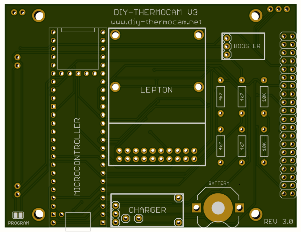
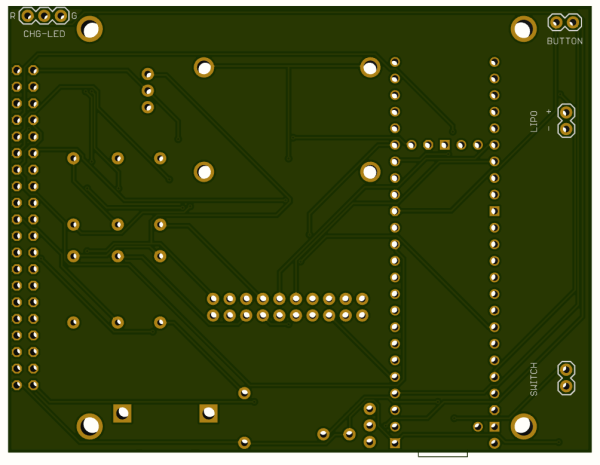

# DIY-Thermocam - PCB

## V3.0 Baseline (Eagle)

The V3.0 printed circuit board in [`eagle-v3.0/`](eagle-v3.0/) was created with Autodesk Eagle:

- Schematic: [`eagle-v3.0/pcb.sch`](eagle-v3.0/pcb.sch)
- Board layout: [`eagle-v3.0/pcb.brd`](eagle-v3.0/pcb.brd)
- Manufacturing Gerbers: [`eagle-v3.0/gerber.zip`](eagle-v3.0/gerber.zip)

Board dimensions: **89.4 mm (w) × 68.4 mm (h)**, 1.6 mm thickness, 2 layers.

### Front

### Back

