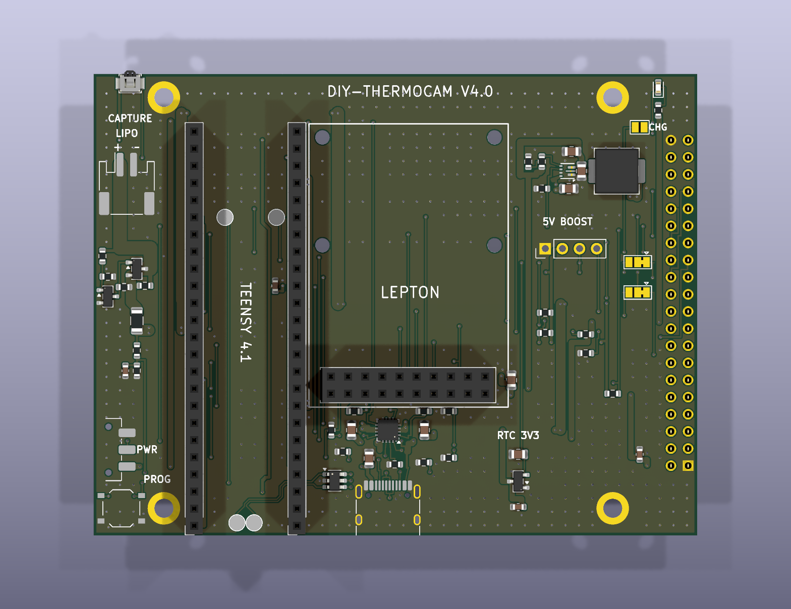

# DIY-Thermocam PCB (KiCad 10)

Native KiCad 10 hardware project and fabrication pipeline for the **DIY-Thermocam V4.0 Zero-Solder PCBA**. The proven V3.0 Eagle baseline remains preserved at git tag [`3.0.4`](https://github.com/maxritter/diy-thermocam/tree/3.0.4/pcb).

> **Prototype Gate:** V4.0 (`hardware/pcb/`) is `PROTOTYPE-PENDING` until Max builds and verifies a physical unit. Check USB-C power/data, pogo-pin D+/D- alignment on Teensy 4.1, 5 V boost thermals, and enclosure fit before treating it as proven. V3.0 (tag `3.0.4`) remains the default buildable board today.

## V4.0 Zero-Solder PCBA (`PROTOTYPE-PENDING`)

V4.0 keeps the exact `89.4 × 68.4 mm` outline, mounting-hole grid, and module positions of V3.0. It removes hand soldering and fixes V3.0 hardware pain points.

### Why plug-in modules

V4.0 keeps Teensy 4.1 (pre-pinned), FLIR Lepton Breakout V2.0, and BuyDisplay `ER-TFTM032-3` as plug-in modules on factory-soldered female sockets:

1. **Unified firmware:** V3.0 and V4.0 run the exact same Teensy 4.1 `.hex` binary.
2. **Simple sourcing:** Avoids sourcing a bare `MIMXRT1062` BGA, proprietary PJRC `MKL02` bootloader IC, and bare Molex Lepton socket.
3. **Low-cost PCBA:** Uses a 2-layer, single-sided `B.Cu` SMD assembly for predictable prototype bring-up.

### Engineering summary

| Area | V4.0 implementation |
| --- | --- |
| **Module parity** | `J1` (BuyDisplay 2×20 on `F.Cu`), `J2` (Lepton 2×10 on `B.Cu`), and `J5`/`J6`/`J7` (Teensy 4.1 on `B.Cu`) match V3.0 at `0.00 mm` XY error. `J1.36/37/40` stay cleared for FT6206 safety. |
| **USB-C & ESD** | `TYPE-C-31-M-12` (`J3`, `C165948`) on `B.Cu` at `Y = -3.35 mm` (`0.8 mm` edge overhang), dual `5.1 kΩ` CC pull-downs (`R7`/`R8`), and `USBLC6-2SC6` (`D1`, `C7519`) ESD array. |
| **Teensy USB pogo pins** | `P1` (`D+`, `65.63, -2.15`) and `P2` (`D-`, `68.17, -2.15`) use `YTC1P-8535-01` (`C5221289`, `12.0 mm` free / `11.0 mm` working height) routed as a length-matched pair (`0.00 mm` skew). Teensy `VUSB` stays open. |
| **Power-path charger** | TI `BQ24074RGTR` (`U3`, `C54313`) regulates `VSYS` to `4.4 V` for reliable USB-only cold start. Configured for `1.3 A` input (`R11 = 1.2 kΩ`), `890 mA` charge (`R10 = 1.0 kΩ`), `90 mA` termination (`R23 = 3.0 kΩ`, `C4211`), `R9 = 10 kΩ` `TS`, `R14 = 47 kΩ` `~6.3 h` timer, and red `~CHG` LED (`D2`). |
| **LiPo polarity safety** | Right-angle JST-PH (`J4`, `S2B-PH-SM4-TB`, `C295747`) uses standard Adafruit/SparkFun polarity (`Pad 1 = +`, `Pad 2 = -`). Protected by `AO3401A` (`Q1`, `C15127`) + `AO3400A` (`Q2`, `C20917`) active interlock (`<10 µA`) and a `2 A` 1206 PTC fuse (`F1`, `C20988`). |
| **5 V synchronous boost** | TI `TPS61022RWUR` (`U2`, `C915088`, `5.10 V` via `750 kΩ`/`100 kΩ`) with `FXL0630-1R0-M` (`L1`, `C167216`, `1.0 µH`, `15 A` `Isat`). `0.80 mm` power trunks and local `22 µF` decoupling (`C4`/`C9`). |
| **RTC & voltage sense** | `XC6206P332MR-G` (`U4`, `C5446`, `1 µA`, `3.3 V`) feeds `VBAT` from `VLIPO`, removing the CR1220 coin cell. Dividers use `47 kΩ / 100 kΩ` (`R1`/`R2`) and `100 kΩ / 100 kΩ` (`R3`/`R5`). |
| **Onboard controls** | Right-angle SMD power switch `SW1` (`C221660`, drives `U2 EN` so battery charges while OFF), capture button `SW2` (`C963349`), and `PROG` pinhole button `SW3` (`C318884`). |
| **Touch & expansion** | Resistive touch works out of the box. Cut-and-bridge jumpers `JP1` (`D9`/`SCL0`), `JP2` (`D5`/`SDA0`), and `JP3` (`CTP_INT`) allow switching cleanly to FT6206 capacitive touch. `J8` provides unpopulated I2C pads. |
| **Signal & fab checks** | Stitched `F.Cu`/`B.Cu` `GND` planes, `2.8 mm` M2.5 corner holes, 31 verified LCSC SKUs, and calibrated JLCPCB/Seeed CPL rotations. `kicad-cli sch erc` and `pcb drc --refill-zones` report `0 errors`. |

> **Pre-order checks:**
> 1. PJRC publishes no mechanical drawing for Teensy 4.1 underside `D+`/`D-` pads. Verify `P1`/`P2` XY and polarity on a physical Teensy 4.1 with calipers and a multimeter before ordering PCBA.
> 2. Pre-pinned Teensy 4.1 boards only populate the outer 48 pins. Solder a 1×5 pin header to Teensy's inner `VBAT`/`PROG` pads to engage `J7`.
> 3. Do not plug a second USB cable directly into Teensy's micro-USB port while USB-C is connected unless you cut Teensy's `VUSB–VIN` pad.
> 4. Use a UL/IEC 62133 certified protected `505060` (`≤5.0 mm` thick) 2000 mAh LiPo for the 3D enclosure cradle.

### V4.0 KiCad 10 Renders (`PROTOTYPE-PENDING`)

| Display Side (`F.Cu`) | Lepton / PCBA Side (`B.Cu`) |
| --- | --- |
|  |  |

## Turnkey Fabrication Pipeline (`scripts/export_fab.py`)

Regenerate the complete V4.0 manufacturing package with KiCad 10:

```bash
python3 hardware/pcb/scripts/export_fab.py
```

Outputs under `hardware/pcb/fab/`:
- `diy-thermocam-v4.0-gerbers.zip` — 2-layer Gerbers and Excellon `.drl` drills
- `diy-thermocam-v4.0-bom-{jlcpcb,seeed,pcbway}.csv` — PCBA BOMs with LCSC and MPN columns
- `diy-thermocam-v4.0-cpl-{jlcpcb,seeed}.csv` — Calibrated pick-and-place centroid files
- `diy-thermocam-v4.0.step` — 3D STEP model for enclosure checks
- `diy-thermocam-v4.0-schematic.pdf` and `*-{top,bottom}.{svg,png}` — Schematic and board renders

### Ordering Instructions

Common specs: **2 layers, `89.4 × 68.4 mm`, `1.6 mm` FR4, `1 oz` copper, Lead-Free HASL or ENIG, Matte Green or Black soldermask**.

1. **JLCPCB / JLC PCBA:** Upload `diy-thermocam-v4.0-gerbers.zip`, `diy-thermocam-v4.0-bom-jlcpcb.csv`, and `diy-thermocam-v4.0-cpl-jlcpcb.csv`. Select **Bottom Side** PCBA (optionally hand-solder Top `J1` to keep assembly single-sided). Verify part orientation preview for `U3`, `U2`, `D1`, `J3`, `J4`, `Q1`, `Q2`, and `D2`.
2. **Seeed Studio Fusion:** Upload `diy-thermocam-v4.0-gerbers.zip`, `diy-thermocam-v4.0-bom-seeed.csv`, and `diy-thermocam-v4.0-cpl-seeed.csv`. Select Bottom-side SMD plus THT sockets (`J1` on Top, `J2`/`J5`/`J6`/`J7` on Bottom).
3. **PCBWay:** Upload `diy-thermocam-v4.0-gerbers.zip`, `diy-thermocam-v4.0-bom-pcbway.csv`, and `diy-thermocam-v4.0-cpl-jlcpcb.csv`.
