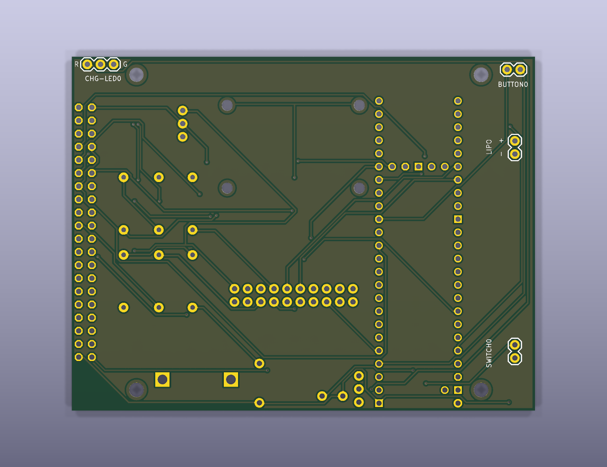
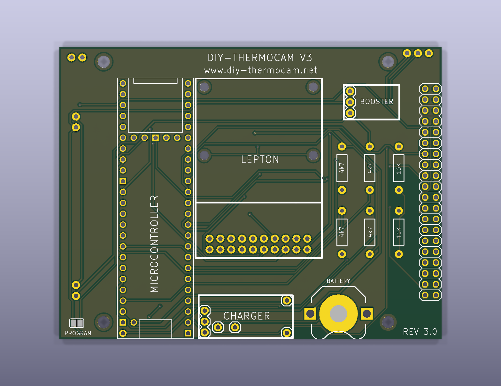
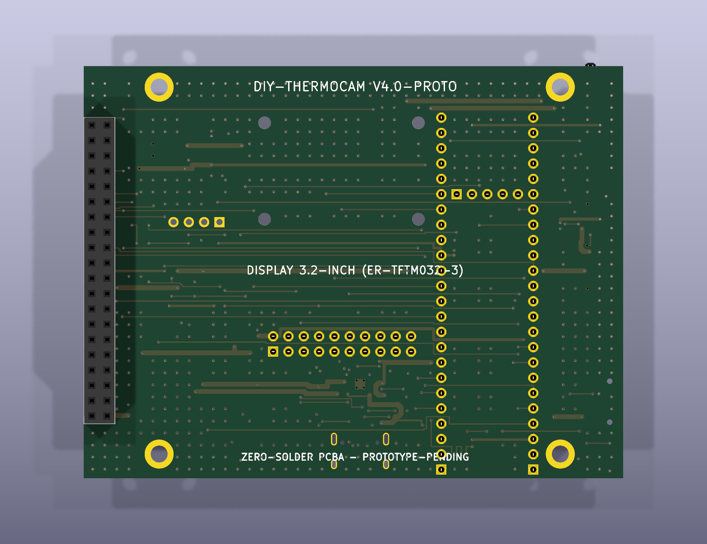
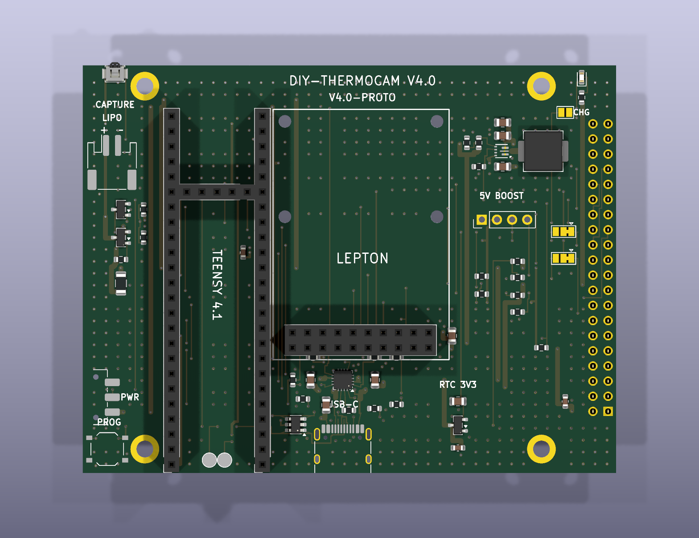

# DIY-Thermocam — PCB

Native **KiCad 10** hardware projects and turnkey fabrication pipelines for DIY-Thermocam, keeping the legacy **Autodesk Eagle V3.0** files intact as the untouched baseline.

| Revision | Status | Assembly Effort | Folder |
|---|---|---|---|
| **V3.0 (KiCad 10 1:1 Port)** | **Proven & Buildable Today** (verified 1:1 vs Eagle V3.0) | Through-hole hand soldering + Teensy VUSB cut | [`kicad-v3.0/`](kicad-v3.0/) |
| **V3.0 (Legacy Eagle Baseline)** | **Frozen Reference** (100% untouched) | Original Eagle 9.6.2 sources & Gerbers | [`eagle-v3.0/`](eagle-v3.0/) |
| **V4.0 (Zero-Solder PCBA)** | **`PROTOTYPE-PENDING`** (unproven until physically manufactured & verified by Max) | **Zero hand soldering** — factory PCBA + screwdriver-only snap-in assembly | [`kicad-v4.0/`](kicad-v4.0/) |

> **Physical Prototype Gate:** **V4.0 (`kicad-v4.0/`) is strictly `PROTOTYPE-PENDING`** until Max manufactures, assembles, and verifies a physical unit (including USB-C charging/data, pogo-pin D+/D- alignment on Teensy 4.1, onboard 5V boost thermals, and mechanical enclosure fit). **V3.0 (`kicad-v3.0/` / `eagle-v3.0/`) remains the proven default buildable board** until physical V4.0 bring-up succeeds.

---

## 1. Verified 1:1 KiCad 10 V3.0 Port (`kicad-v3.0/`)

Exact 1:1 port of [`eagle-v3.0/pcb.sch`](eagle-v3.0/pcb.sch) and [`eagle-v3.0/pcb.brd`](eagle-v3.0/pcb.brd) into native KiCad 10 S-expression files (`89.4 × 68.4 mm`, 2-layer, 1.6 mm FR4, all 21 components, all 30 active electrical nets, exact pad/track/via/drill coordinates).

### Automated Verification (`scripts/verify_v3_port.py`)

Run anytime to re-verify 1:1 fidelity against the frozen Eagle baseline:

```bash
python3 hardware/pcb/scripts/verify_v3_port.py
```

Latest verification results ([`kicad-v3.0/verification-report.json`](kicad-v3.0/verification-report.json)):

- **Schematic ERC (`kicad-cli sch erc`):** `0 errors, 0 warnings`
- **PCB DRC (`kicad-cli pcb drc`):** `0 errors, 0 unconnected items` (Eagle-original silkscreen/mounting-via warnings preserved intentionally for 1:1 copper/outline parity)
- **Netlist Parity (PCB & Schematic vs Eagle `<signals>`):** `21/21 parts, 30/30 active nets (100% exact match)`
- **Excellon Drills (vs `eagle-v3.0/gerber.zip`):** `182/182 hits matched, max XY error = 0.0000 mm, max diameter error = 0.0000 mm`
- **600 DPI `gerbv` Layer XOR:** `Edge_Cuts = 0.000% diff (100.00% IoU)`, `F_Cu = 98.07% IoU`, `B_Cu = 92.61% IoU` (copper tracks/pads identical; minor delta is KiCad vs Eagle polygon pour beveling on the floating V3.0 `N$2`/`N$3` zones)

### V3.0 KiCad 10 Renders

| Display Side (`F.Cu`) | Lepton / Component Side (`B.Cu`) |
|---|---|
|  |  |

---

## 2. DIY-Thermocam V4.0 — Zero-Solder PCBA (`kicad-v4.0/`, `PROTOTYPE-PENDING`)

**V4.0** keeps the exact `89.4 × 68.4 mm` outline, mounting-hole grid, and Display / Lepton / Teensy module positions while eliminating **100% of hand soldering** and fixing every V3.0 hardware pain point:

### Architectural Rationale (Why Plug-In Modules Over Bare BGA)

V4.0 intentionally keeps **Teensy 4.1 (pre-pinned)**, **FLIR Lepton Breakout V2.0**, and **BuyDisplay `ER-TFTM032-3`** as snap-in modules plugged into factory-soldered female headers rather than integrating a bare `MIMXRT1062` BGA + proprietary PJRC `MKL02` bootloader IC or bare Molex Lepton socket:

1. **100% unified Teensy 4.1 firmware parity** (same `.hex` firmware for V3.0 and V4.0).
2. **No proprietary PJRC bootloader sourcing bottlenecks** at JLCPCB / Seeed Studio Fusion.
3. **Affordable 2-layer, single-sided SMD PCBA** (`B.Cu` only) maximizing first-prototype bring-up reliability.

### Key V4.0 Engineering Upgrades (Audited & Cost-Optimized)

- **Exact V3.0 Module Header Parity (Automated `0.00 mm` XY + Net Assertion):** `J1` (BuyDisplay 2×20 on `F.Cu`), `J2` (FLIR Lepton 2×10 on `B.Cu`), and `J5`/`J6`/`J7` (Teensy 4.1 on `B.Cu`) are automatically verified against `kicad-v3.0` (`47/47` connected pads at `0.00 mm` XY error, with `J1.36/37/40` cleared for FT6206 safety).
- **Board-Edge USB-C + ESD (`J3`, `D1`, `R7`, `R8`):** `TYPE-C-31-M-12` (`C165948`) at Eagle `(45.80, 0.0)` with datasheet `0.8 mm` board-edge overhang (`Y = -3.35 mm` center) on `B.Cu`, 2× `5.1 kΩ` CC sink pull-downs, and `USBLC6-2SC6` (`C7519`) TVS ESD array.
- **Zero-Solder Teensy 4.1 USB D+/D- (`P1`, `P2`) — Matched Differential Pair:** Teensy `VUSB` is left open on the V4.0 socket (Teensy is powered via `5V` on `VIN`; do not plug a second USB cable directly into Teensy's onboard micro-USB while USB-C is connected — or cut Teensy's `VUSB–VIN` jumper pad). Two `12.0 mm` free / `11.0 mm` working-height SMD spring pogo pins (`YTC1P-8535-01`, `C5221289`, matched to `8.5 mm` sockets + `2.54 mm` Teensy shroud = `11.04 mm` gap) sit at `XenGi/teensy.pretty` `Teensy41` coordinates (`P1 D+` at `(65.63, -2.15)` GND side, `P2 D-` at `(68.17, -2.15)` VIN side) routed as a length-matched pair (`0.00 mm` skew). **Pre-Order Prototype Check:** PJRC does not publish an official mechanical drawing for Teensy 4.1 underside `D+`/`D-` pads — **spot-check `P1`/`P2` XY and polarity against a physical Teensy 4.1 with calipers and continuity meter before ordering PCBA.** Also note that pre-pinned Teensy 4.1 boards only populate the outer 48 pins; solder a 1×5 pin header onto Teensy's inner `VBAT`/`PROG` pads to engage `J7`.
- **TI `BQ24074RGTR` Dynamic Power-Path Charger (`U3`, `C54313`):** Pin-compatible VQFN-16 regulating `VSYS` to `4.4 V` (`< TPS61022` `4.8 V` cold-start `VIN(max)` for guaranteed USB-only cold-start!), `0.3 mm` thermal vias on pad 17 (JLCPCB 2-layer spec), `EN2` pulled to regulated `VSYS` via `10 kΩ` `R22` (never 28V-tolerant `VBUS`), `1.3 A` input limit (`R11 = 1.2 kΩ` ≥ TI `1.1 kΩ` min), `890 mA` charge current (`R10 = 1.0 kΩ`), `90 mA` (`10.1%`) termination (`R23 = 3.0 kΩ` Basic `C4211` on `ITERM`), `R9 = 10 kΩ` `TS`, `R14 = 47 kΩ` `~6.3 h` safety timer, tight local `10 µF` decoupling (`C1`–`C3`), and single Basic Red `~CHG` LED (`D2` at `(5.75, -66.40)`).
- **Bulletproof Active LiPo Reverse-Polarity Safety Chain (`J4`, `Q1`, `Q2`, `R18`, `R20`, `R21`, `F1`):** SMD right-angle JST-PH (`S2B-PH-SM4-TB`, `C295747`) wired to **standard Adafruit/SparkFun/DigiKey physical LiPo polarity** (verified against Adafruit Feather M0/32u4, PowerBoost 1000C & SparkFun LiPo Charger Basic: KiCad `Pad 1 = VBAT+ / +` on the right when facing signal pads, `Pad 2 = GND / -`, matching silkscreen `+`/`-`) → `AO3401A` (`C15127`) P-MOSFET + `AO3400A` (`C20917`) NMOS gate-interlock (`<10 µA` quiescent draw; stays hard-OFF into a reversed LiPo even when USB-C is plugged in!) → `2 A` hold / `3.5 A` trip 1206 PTC fuse (`SMD1206P200TF`, `C20988`). Requires a UL/IEC 62133 certified protected LiPo pack (`≤5.0 mm` thick `505060` cell for the 3D enclosure cradle).
- **Onboard 5V Synchronous Boost (`U2`, `L1`):** TI `TPS61022RWUR` (`C915088`, `8 A` switch, `5.10 V` via `R16 = 750 kΩ` `C23240` / `R17 = 100 kΩ` `C25803`, true load disconnect when disabled) with `FXL0630-1R0-M` (`C167216`, `1.0 µH`, `15 A` `Isat`, `12 A` `Irms`), `1.0 mm` `BOOST_SW` link, `C4`/`C9` (`22 µF`) placed directly at `U2.3`/`U2.1` on `B.Cu` with `0.80 mm` pours, and `0.80 mm` high-current power trunks (`VBUS`/`VLIPO`/`VSYS`/`5V`).
- **Zero-Coin-Cell RTC Supply (`U4`) & Low-Drain Sensing (`R1`–`R5`):** Replaces the Extended CR1220 holder with a JLCPCB Basic `1 µA` `XC6206P332MR-G` LDO (`C5446`, `3.3 V` within NXP i.MX RT1062 `VDD_SNVS_IN` `2.4–3.6 V` spec) from `VLIPO → VBAT`. Voltage dividers scaled to `R1 = 47 kΩ / R2 = 100 kΩ` (`<29 µA`, exact `10/14.7` firmware ratio) and `R3 = 100 kΩ / R5 = 100 kΩ` (`2.5 V < 3.3 V` Teensy ADC max on `A16`).
- **Zero-Solder Onboard Controls (Synced w/ Parametric Enclosure):** Right-angle SMD power slide switch (`SW1`, `JS102011SAQN` `C221660` at `(87.20, -12.70)` driving `TPS61022 EN` so battery charges while OFF), right-angle SMD capture button (`SW2`, `B3U-3000P` `C963349` at `(84.00, -67.00)`), and Teensy `PROG` pinhole button (`SW3`, `TS-1187A-B-A-B` `C318884` at `(85.30, -4.00)`).
- **Display & Sensor Compatibility:** 100% V3.0 resistive touch compatibility out of the box (`J1.36/37/40` cleared to prevent `ER-TFTM032-3` bus/reset conflicts); 3-pad cut-and-bridge jumpers `JP1` (`1=D9 — 2=J1.30 — 3=D19 SCL0`, default 1-2 copper-bridged) and `JP2` (`1=D5 — 2=J1.31 — 3=D18 SDA0`, default 1-2 copper-bridged) plus open `JP3` (`J1.39 ↔ D4 CTP_INT`) allow switching cleanly to FT6206 capacitive touch by cutting 1-2 and bridging 2-3 with **zero `SCL↔D9` bus contention**. Orphaned auxiliary backlight FET removed (`D22` drives `J1.29` directly with `10 kΩ` `R19` pull-up). Unpopulated 4-pin 2.54 mm I2C expansion pads (`J8`, DNP).
- **Signal Integrity, Verified LCSC BOM, Calibrated CPL & Assembly Notes:** Continuous `2.0 mm`-stitched `F.Cu` + `B.Cu` `GND` planes, standardized `2.8 mm` M2.5 corner mounting holes, all BOM LCSC part numbers verified in-stock on JLCPCB, `U3`/`J3` accurately classified `Mount=SMD`, and `export_fab.py` applies EasyEDA/JLCPCB vendor-basis CPL rotation/origin calibration (`Q1`/`Q2`/`U4` +180°, `D1` +90°, `SW1`/`J3`/`U2` origin offsets, `J2`/`J5`/`J6`/`J7` geometric midpoints & axes). For lowest PCBA cost, order single-sided `B.Cu` SMD PCBA and optionally hand-solder the `F.Cu` Display socket `J1` (or select double-sided THT assembly).
- **Verification:** `kicad-cli sch erc` = `0 errors, 0 warnings`; `kicad-cli pcb drc --refill-zones` = `0 errors, 0 unconnected items`.

### V4.0 KiCad 10 Renders (`PROTOTYPE-PENDING`)

| Display Side (`F.Cu`) | Lepton / PCBA Side (`B.Cu`) |
|---|---|
|  |  |

---

## 3. Turnkey Fabrication Pipeline (`scripts/export_fab.py`)

Regenerate complete manufacturing packages for V3.0 and V4.0 in one command (requires KiCad 10):

```bash
python3 hardware/pcb/scripts/export_fab.py --rev all
```

Outputs under `kicad-<rev>/fab/`:
- `diy-thermocam-<rev>-gerbers.zip` — Standard 2-layer Gerbers (`F_Cu`, `B_Cu`, `F_Mask`, `B_Mask`, `F_Silkscreen`, `B_Silkscreen`, `F_Paste`, `B_Paste`, `Edge_Cuts`) + Excellon `.drl` drills
- `diy-thermocam-<rev>-bom-{jlcpcb,seeed,pcbway}.csv` — Joined PCBA BOMs with LCSC / MPN columns
- `diy-thermocam-<rev>-cpl-{jlcpcb,seeed}.csv` — Pick-and-place centroid files
- `diy-thermocam-<rev>.step` — 3D STEP model for enclosure fit verification
- `diy-thermocam-<rev>-schematic.pdf`, `*-{top,bottom}.{svg,png}` — Printable schematic & board previews

### One-Click Ordering Instructions

Common PCB specs (both V3.0 & V4.0): **2 layers, 89.4 × 68.4 mm, 1.6 mm FR4, 1 oz copper, Lead-Free HASL or ENIG, Matte Black or Green soldermask**.

1. **Seeed Studio Fusion PCB / PCBA (Recommended One-Stop w/ 3D Print):**
   - Upload `diy-thermocam-<rev>-gerbers.zip` to [Seeed Fusion PCB](https://www.seeedstudio.com/fusion_pcb.html).
   - For V4.0 turnkey PCBA, enable **PCBA**, upload `diy-thermocam-v4.0-bom-seeed.csv` and `diy-thermocam-v4.0-cpl-seeed.csv`, select **Bottom-side SMD + THT sockets** (`J1` Display socket on Top, `J2`/`J5`/`J6`/`J7` sockets on Bottom).
2. **JLCPCB / JLC PCBA:**
   - Upload `diy-thermocam-<rev>-gerbers.zip` to [JLCPCB](https://cart.jlcpcb.com/quote).
   - For V4.0 PCBA, enable **PCB Assembly → Economic/Standard PCBA → Bottom Side**, upload `diy-thermocam-v4.0-bom-jlcpcb.csv` and `diy-thermocam-v4.0-cpl-jlcpcb.csv`, confirm orientation preview for `U3`, `U2`, `D1`, `J3`, `J4`, `Q1`, `Q2`, and `D2`.
3. **PCBWay:**
   - Upload `diy-thermocam-<rev>-gerbers.zip` + `diy-thermocam-<rev>-bom-pcbway.csv` + `diy-thermocam-<rev>-cpl-jlcpcb.csv` at [PCBWay Turnkey](https://www.pcbway.com/quotesmt.aspx).
